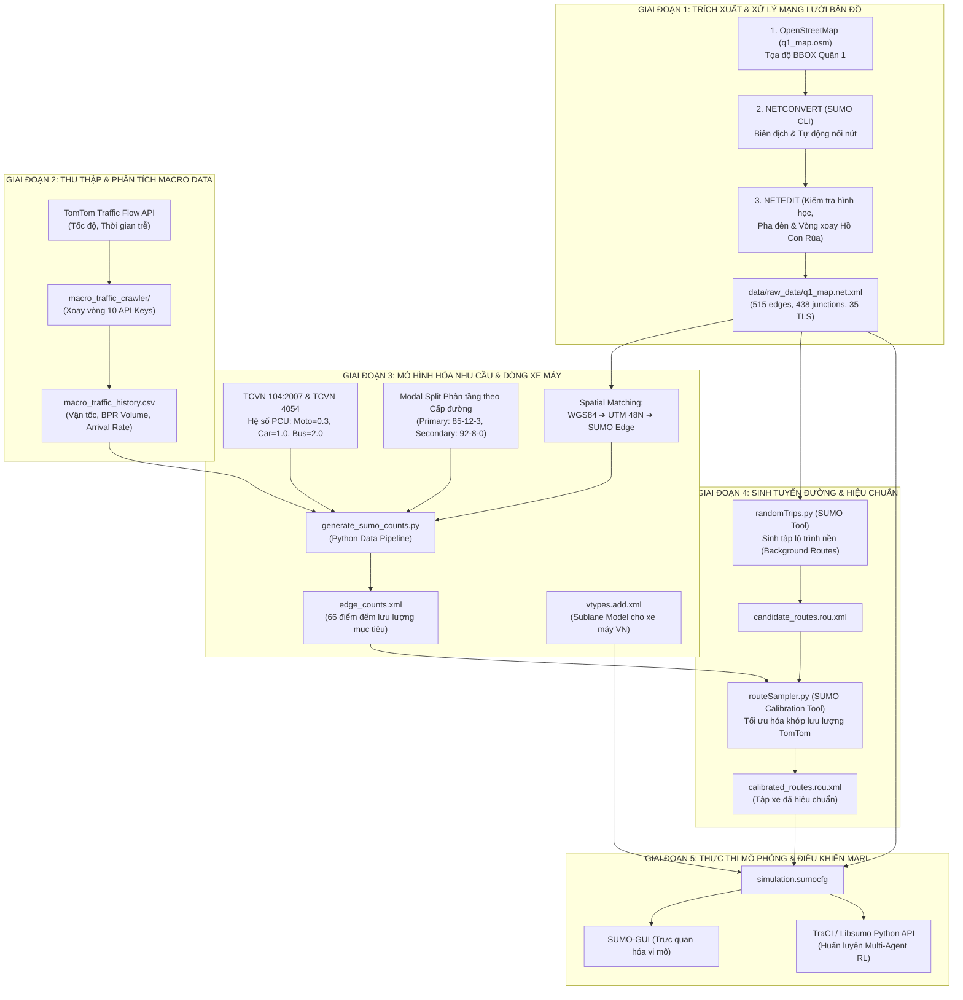

# XÂY DỰNG BỘ DỮ LIỆU & PIPELINE MÔ PHỎNG GIAO THÔNG QUẬN 1 (TP. HỒ CHÍ MINH)

> **Mục tiêu:** 
> 1. Xây dựng kịch bản giao thông vi mô thực tế tại khu vực trung tâm TP.HCM (Quận 1 - Quận 3 quanh Dinh Độc Lập và Vòng xoay Hồ Con Rùa).
> 2. Chuyển đổi dữ liệu lưu lượng vĩ mô (TomTom Probe Data) thành luồng xe vi mô trong SUMO.
> 3. Mô phỏng đặc thù dòng xe máy hỗn hợp không tuân thủ làn cứng (Sublane Model).
> 4. Hiệu chuẩn (Calibration) để lưu lượng trong mô phỏng khớp với thực tế ngoài đời.

---

## SƠ ĐỒ PIPELINE TỔNG THỂ



---

## CHI TIẾT TỪNG BƯỚC THỰC HIỆN TRONG PIPELINE

### BƯỚC 1: TRÍCH XUẤT VÀ DỰNG BẢN ĐỒ MẠNG LƯỚI SUMO

* **Công cụ sử dụng:** OpenStreetMap (OSM), `netconvert` (SUMO Command Line), `netedit` (SUMO GUI).
* **Đầu vào:** Tọa độ địa lý Bounding Box khu vực nghiên cứu:
  * `Upper (Bắc):` 10.782068
  * `Bottom (Nam):` 10.775291
  * `Left (Tây):` 106.686022
  * `Right (Đông):` 106.698661
* **Cách thực hiện:**
  1. Trích xuất file dữ liệu thô OSM: `macro_traffic_crawler/data/raw/q1_map.osm`.
  2. Sử dụng lệnh `netconvert` với cờ cấu hình tối ưu hóa cho mạng lưới đô thị Việt Nam:
     ```bash
     netconvert --osm-files macro_traffic_crawler/data/raw/q1_map.osm \
                -o data/raw_data/q1_map.net.xml \
                --geometry.remove \
                --roundabouts.guess \
                --ramps.guess \
                --junctions.join \
                --tls.guess-signals \
                --tls.discard-simple \
                --tls.join
     ```
  3. **Ý nghĩa các tham số:**
     * `--roundabouts.guess`: Nhận diện hình học vòng xoay Hồ Con Rùa thành `<roundabout>` trong SUMO để áp dụng luật nhường đường chuẩn.
     * `--junctions.join`: Gom các cụm nút giao nhỏ phức tạp sát nhau thành một giao lộ duy nhất.
     * `--tls.guess-signals` & `--tls.join`: Tự động nhận diện và ghép các đèn tín hiệu giao thông (TLS) liên kết.
     * `--geometry.remove`: Tránh đường bị chia vụn thành hàng trăm đoạn nhỏ.
     * `--ramps.guess`: Tránh xe dừng khựng vô lý tại các góc rẽ phải, vòng xoay.
     * `--tls.discard-simple`: Loại bỏ đèn tín hiệu ở nút giao thông (có 1 hướng vào,ra hoặc các đoạn thẳng giao thông không có luồng xe cắt qua ).

* * **Đầu ra:** File mạng lưới hoàn chỉnh `data/raw_data/q1_map.net.xml` (gồm 515 cạnh, 438 nút giao, 35 cụm đèn tín hiệu và 2 vòng xoay).

---

### BƯỚC 2: THU THẬP DỮ LIỆU MACRO TỪ TOMTOM TRAFFIC API

* **Công cụ sử dụng:** Python (`requests`, `pandas`), TomTom Traffic Flow API.
* **Mã nguồn:** `macro_traffic_crawler/extract_osm_points.py`, `scheduled_crawler.py`.
* **Cách thực hiện:**
  1. Dùng `extract_osm_points.py` trích xuất 66 điểm đo trọng yếu (bao phủ đủ các trục chính Nam Kỳ Khởi Nghĩa, Pasteur, Lê Duẩn, Nguyễn Thị Minh Khai, và 4 cung phần tư của vòng xoay Hồ Con Rùa).
  2. Dùng `scheduled_crawler.py` xoay vòng API Keys để cào dữ liệu định kỳ.
  3. Tính toán Khả năng thông hành làn đường $C$ theo chuẩn **TCVN 13592:2022** [1] và ước tính lưu lượng xe theo hàm **BPR (Bureau of Public Roads)** [2]:
     $$V = C \times \left( \frac{t - t_0}{0.15 \times t_0} \right)^{1/4}$$
* **Đầu ra:** `macro_traffic_dense_1min.csv` chứa vận tốc thực tế, vận tốc tự do, độ trễ và lưu lượng quy đổi (PCU/h).

---

### BƯỚC 3: MÔ HÌNH HÓA NHU CẦU & ĐẶC TÍNH XE MÁY HỖN HỢP

* **Công cụ sử dụng:** Python (`generate_sumo_counts.py`), XML.
* **Cách thực hiện:**
  1. **Quy đổi PCU sang Phương tiện Vật lý (Physical Vehicles):**
     * Tham chiếu **TCVN 104:2007 Bảng 2**: Xe máy = 0.30 PCU, Ô tô con = 1.00 PCU, Xe buýt = 2.00 PCU.
  2. **Phân tầng Tỷ lệ Phương tiện (Modal Split) theo cấp đường:**
     * Trục chính lớn (Primary): 85% Xe máy - 12% Ô tô - 3% Xe buýt.
     * Đường nhánh/gom (Secondary/Tertiary): 92% Xe máy - 8% Ô tô - 0% Xe buýt.
     * Đường nội bộ dân cư (Residential): 96% Xe máy - 4% Ô tô - 0% Xe buýt. [3]
  3. **Ánh xạ Không gian (Spatial Matching):**
     * Chuyển đổi tọa độ GPS $(lat, lon)$ sang hệ tọa độ phẳng UTM Zone 48N, cộng vector bù tọa độ `netOffset` của file `q1_map.net.xml`.
     * Tìm đoạn đường (edge) gần nhất trên bản đồ SUMO bằng thuật toán khoảng cách Euclidean điểm-đoạn thẳng.
  4. Chạy lệnh tạo file đếm xe mục tiêu:
     ```bash
     python macro_traffic_crawler/generate_sumo_counts.py
     ```
  5. **Cấu hình Hành vi Xe máy Việt Nam (Sublane Model) trong `vtypes.add.xml`:**
     Xe máy tại Việt Nam luồn lách tự do, không chạy thẳng hàng trong 1 làn cứng. Cần cấu hình mô hình Sublane [4]:
     ```xml
     <additional>
         <!-- Xe máy: luồn lách tự do, khoảng cách an toàn ngang nhỏ -->
         <vType id="motorcycle" vClass="motorcycle" length="1.8" width="0.8" 
                maxSpeed="13.88" accel="2.5" decel="4.5"
                latAlignment="arbitrary" minGapLat="0.2" minGap="0.5"/>
         
         <!-- Ô tô con -->
         <vType id="passenger" vClass="passenger" length="4.5" width="1.8" 
                maxSpeed="16.67" accel="2.0" decel="4.5"
                latAlignment="center" minGapLat="0.6" minGap="1.5"/>
                
         <!-- Xe buýt -->
         <vType id="bus" vClass="bus" length="10.5" width="2.5" 
                maxSpeed="11.11" accel="1.2" decel="3.5"
                latAlignment="right" minGapLat="0.8" minGap="2.5"/>
     </additional>
     ```
* **Đầu ra:** File cảm biến đếm xe `edge_counts.xml` và định nghĩa phương tiện `vtypes.add.xml`.

---

### BƯỚC 4: SINH LỘ TRÌNH VÀ HIỆU CHUẨN LƯU LƯỢNG (CALIBRATION)

* **Công cụ sử dụng:** `randomTrips.py`, `routeSampler.py` (Bộ công cụ chính thức trong thư mục `$env:SUMO_HOME\tools` của SUMO).
* **Bộ dữ liệu sử dụng:** `macro_traffic_dense_1min.csv` (14,124 bản ghi, 66 điểm cảm biến, độ dài 24,356 giây ~ 6.75 tiếng từ 15:33 đến 22:20).

* **Cách thực hiện trên Windows PowerShell:**

  1. **Tạo file đếm xe mục tiêu (Demand Modeling):**
     * **Cách A - Toàn bộ dữ liệu (6.75 tiếng / 24,356 giây):**
       ```powershell
       python macro_traffic_crawler\generate_sumo_counts.py --input macro_traffic_crawler\data\processed\macro_traffic_dense_1min.csv --output macro_traffic_crawler\data\processed\edge_counts.xml
       ```
     * **Cách B - Khung giờ cao điểm 4 tiếng (16:00 đến 20:00 = 14,400 giây):**
       ```powershell
       python macro_traffic_crawler\generate_sumo_counts.py --input macro_traffic_crawler\data\processed\macro_traffic_dense_1min.csv --start-time 16:00 --end-time 20:00 --output macro_traffic_crawler\data\processed\edge_counts_4h.xml
       ```

  2. **Sinh tập lộ trình ứng viên (Candidate Background Routes) với `randomTrips.py`:**
     Tạo tập hợp các chuyến đi đa dạng kết nối các cặp nút nguồn-đích xuyên qua mạng lưới Quận 1:
     ```powershell
     python "$env:SUMO_HOME\tools\randomTrips.py" `
         -n data\raw_data\q1_map.net.xml `
         -r candidate_routes.rou.xml `
         --begin 0 `
         --end 24356 `
         --period 2.0 `
         --min-distance 250 `
         --fringe-factor 5 `
         --intermediate 1 `
         --validate
     ```
     *Lưu ý:* Cờ `--fringe-factor 5` giúp tăng xác suất xe đi vào từ rìa mạng lưới và đi xuyên tâm Quận 1; `--period 2.0` tạo ra khoảng 12,000 lộ trình ứng viên phủ kín 515 cạnh.

  3. **Hiệu chuẩn lưu lượng bằng `routeSampler.py` (Constrained Optimization):**
     Giải bài toán quy hoạch tối ưu để tìm trọng số các lộ trình khớp chính xác với lưu lượng thực tế TomTom 1-phút:
     ```powershell
     python "$env:SUMO_HOME\tools\routeSampler.py" `
         -r candidate_routes.rou.xml `
         -d macro_traffic_crawler\data\processed\edge_counts.xml `
         -o calibrated_routes.rou.xml `
         --attributes 'type=\"hcmc_mixed\"' `
         --write-flows number `
         --optimize full `
         --threads 4
     ```
     *Điểm mấu chốt kỹ thuật:*
     * Cờ `--write-flows number`: Nén lưu lượng 6.75 tiếng (hơn 4 triệu lượt xe) thành các thẻ `<flow>` cực kỳ ngắn gọn (~10 KB thay vì 220 MB), tránh hoàn toàn lỗi tràn RAM máy tính.
     * Cờ `--attributes 'type=\"hcmc_mixed\"'`: Tự động áp dụng phân bố 85% xe máy - 12% ô tô - 3% xe buýt cho từng luồng xe.

* **Đầu ra:** File luồng xe đã được hiệu chuẩn hoàn chỉnh `calibrated_routes.rou.xml`.

---

### BƯỚC 5: TỔ CHỨC FILE CẤU HÌNH & CHẠY MÔ PHỎNG SUMO

* **Công cụ sử dụng:** `sumo-gui` (Trực quan hóa vi mô), `sumo` (Chạy ngầm huấn luyện AI), Python `traci`.
* **Cấu hình file kịch bản `simulation.sumocfg` (Đặt tại thư mục gốc dự án):**
  ```xml
  <configuration xmlns:xsi="http://www.w3.org/2001/XMLSchema-instance" xsi:noNamespaceSchemaLocation="http://sumo.dlr.de/xsd/sumoConfiguration.xsd">
      <input>
          <net-file value="data/raw_data/q1_map.net.xml"/>
          <route-files value="calibrated_routes.rou.xml"/>
          <additional-files value="data/raw_data/vtypes.add.xml"/>
      </input>
      <time>
          <begin value="0"/>
          <end value="24356"/>
          <step-length value="0.5"/>
      </time>
      <processing>
          <!-- Bắt buộc: Kích hoạt mô hình sublane cho xe máy luồn lách tự do -->
          <lateral-resolution value="0.8"/>
          <collision.action value="warn"/>
          <time-to-teleport value="300"/>
      </processing>
  </configuration>
  ```
* **Lệnh thực thi mô phỏng trên Windows PowerShell:**
  * **Trực quan hóa trên giao diện SUMO-GUI:**
    ```powershell
    sumo-gui -c simulation.sumocfg
    ```
  * **Chạy ngầm tốc độ cao (Headless Mode):**
    ```powershell
    sumo -c simulation.sumocfg
    ```
  * **Tích hợp vòng lặp huấn luyện Reinforcement Learning qua Python TraCI:**
    ```python
    import traci

    # Kết nối SUMO với cờ lateral-resolution cho xe máy
    traci.start(["sumo", "-c", "simulation.sumocfg", "--lateral-resolution", "0.8"])
    step = 0
    while traci.simulation.getMinExpectedNumber() > 0:
        traci.simulationStep()
        # Đọc dữ liệu hàng đợi / độ trễ tại các ngã tư đèn giao thông
        # Áp dụng hành động chuyển pha đèn từ thuật toán MARL
        step += 1
    traci.close()
    ```

---

## TÀI LIỆU THAM KHẢO & CƠ SỞ KHOA HỌC

[0] Alvarez Lopez, P. et al. (2018). *Microscopic Traffic Simulation using SUMO*. IEEE 21st ITSC.  
[1] Bộ Xây dựng (2007). *TCVN 104:2007 - Đường đô thị: Yêu cầu thiết kế*. Bảng 2: Hệ số quy đổi xe con (PCU) cho đô thị loại đặc biệt (TP.HCM).  
[2] Bureau of Public Roads (1964). *Traffic Assignment Manual*. U.S. Dept. of Commerce, Urban Planning Division. (Hiệu chuẩn cho giao thông hỗn hợp VN: $\alpha=0.35, \beta=2.5$).  
[3] Krajzewicz, D. et al. (2015). *Sublane Model in SUMO: Simulating Motorcycle Behavior and Lateral Movements*. SUMO Conference Proceedings.  
[4] Minh, C. C., Sano, K., & Matsumoto, S. (2005). *Maneuvers of Motorcycles in Mixed Traffic Conditions: Empirical Study in Vietnam*. Journal of the Eastern Asia Society for Transportation Studies, 6, 178-193.  
[5] Vu, A. T., & Shimizu, T. (2014). *Modeling Passenger Car Units for Motorcycles at Signalized Intersections under Mixed Traffic in Ho Chi Minh City*. Transport and Logistics Studies, 2, 45-56.  
[6] JICA & UBND TP.HCM (2004). *The Study on Urban Transport Master Plan in the Ho Chi Minh City Metropolitan Area (HOUTRANS)*. Final Report, JICA.  
[7] Tuan, V. A. (2016). *Evaluating Traffic Flow Characteristics of Motorcycle-Dominated Urban Street Networks*. Vietnam Journal of Transport and Communications, 10, 32-38.