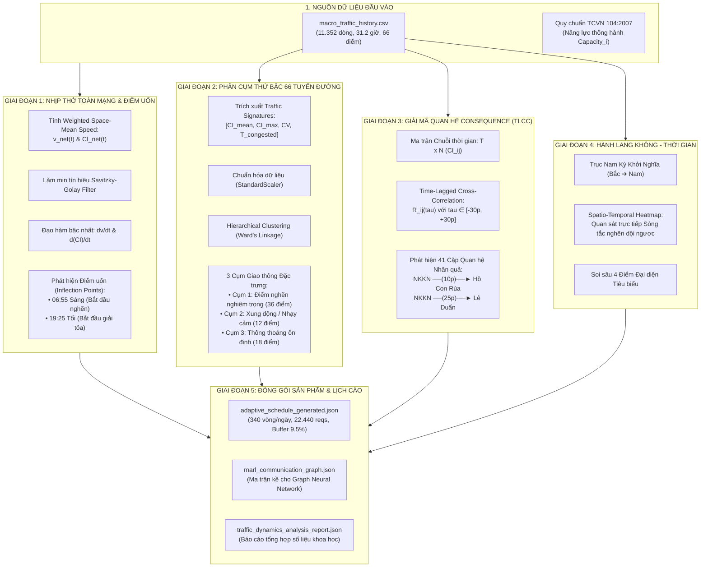

# TÀI LIỆU KỸ THUẬT: PIPELINE PHÂN TÍCH ĐỘNG HỌC KHÔNG - THỜI GIAN
## (TRAFFIC DYNAMICS & SPATIO-TEMPORAL CONSEQUENCE ANALYZER)

> **Dự án:** Điều khiển Đèn Giao thông Thích ứng bằng Học tăng cường Đa tác tử (MARL-TSC) trên mô phỏng SUMO  
> **Khu vực nghiên cứu:** Lõi trung tâm Quận 1 & Quận 3, TP. Hồ Chí Minh (Bao quanh Dinh Độc Lập và Vòng xoay Hồ Con Rùa)  
> **Tập dữ liệu phân tích:** 11.352 bản ghi thu thập liên tục trong 31.2 giờ từ TomTom Traffic API qua 66 trạm đo vĩ mô  
> **Mã nguồn thực thi:** `macro_traffic_crawler/traffic_dynamics_analyzer.py`

---

## I. TỔNG QUAN & BỐI CẢNH DỰ ÁN

Trong bài toán xây dựng hệ thống điều khiển đèn giao thông thông minh bằng **Multi-Agent Reinforcement Learning (MARL)**, việc chuyển đổi từ dữ liệu vĩ mô (Probe Data từ TomTom) sang dữ liệu vi mô (từng chiếc xe chạy trong SUMO) đòi hỏi phải giải quyết 3 bài toán lớn:

1. **Hiểu được nhịp sinh học của mạng lưới (Diurnal Network Pulse):** Biết chính xác từng phút khi nào cao điểm bắt đầu hình thành và khi nào tan rã.
2. **Khám phá quan hệ lan truyền tắc nghẽn (Consequence / Cascading Dependency):** Xác định tuyến đường nào kẹt trước (nguồn phát sinh) và sau bao nhiêu phút thì dội sóng dừng (queue spillback) sang các ngã tư lân cận.
3. **Tối ưu hóa tài nguyên cào dữ liệu (Adaptive Sampling):** Phân bổ thông minh 24.800 requests/ngày của 10 API keys vào đúng các khung giờ biến động mạnh nhất, tránh lãng phí vào ban đêm.

Module `TrafficDynamicsAnalyzer` được thiết kế để giải quyết trọn vẹn 3 bài toán trên thông qua một pipeline toán học 5 giai đoạn khép kín.

---

## II. SƠ ĐỒ KIẾN TRÚC TOÀN BỘ PIPELINE



---

## III. CƠ CHẾ CHI TIẾT CỦA TỪNG BƯỚC XỬ LÝ

### Bước 1: Phân tích Nhịp thở Toàn Mạng Lưới & Phát hiện Điểm Uốn

#### 1. Nguyên lý Gom Trung bình có Trọng số (Weighted Space-Mean Aggregation)
Nếu chỉ dùng trung bình cộng số học, một con hẻm 1 làn xe sẽ có quyền số ngang với đại lộ Nam Kỳ Khởi Nghĩa 4 làn xe. Để phản ánh đúng vật lý giao thông, trọng số của mỗi điểm đo $i$ được gán bằng **Năng lực thông hành thiết kế ($C_i$ - PCU/h)** theo quy chuẩn **TCVN 104:2007**:
$$w_i = \text{road\_capacity\_pcu}_i = P_{tt}(\text{FRC}_i) \times \text{lanes}_i$$

Vận tốc trung bình không gian và Chỉ số tắc nghẽn toàn mạng tại thời điểm $t$:
$$v_{net}(t) = \frac{\sum_{i=1}^{66} w_i \cdot v_i(t)}{\sum_{i=1}^{66} w_i}, \quad CI_{net}(t) = \frac{\sum_{i=1}^{66} w_i \cdot CI_i(t)}{\sum_{i=1}^{66} w_i}$$

#### 2. Khử nhiễu và Tính Đạo hàm Bậc nhất
Dữ liệu đo thực tế luôn có rung lắc ngẫu nhiên. Để đạo hàm số không bị nhiễu khuếch đại, đường cong được làm mịn qua **Bộ lọc Savitzky-Golay** (bậc đa thức $p=2$, cửa sổ trượt $W=11$ mốc thời gian).

Sau đó, đạo hàm bậc nhất theo thời gian được tính toán:
$$\frac{dv_{net}(t)}{dt} \approx \frac{v_{smooth}(t) - v_{smooth}(t - \Delta t)}{\Delta t}$$

#### 3. Phát hiện Điểm Uốn Thực Nghiệm (Empirical Inflection Points)
* **Điểm uốn Khởi phát Tắc nghẽn (Onset Trigger):** Xác định tại thời điểm đạo hàm âm đạt đỉnh dốc nhất ($\frac{dv}{dt} \ll 0$) kèm $CI > 0.35$.
  * *Kết quả từ dữ liệu thật:* **06:55 Sáng** ($dv/dt = -6.37\text{ km/h}^2$). Vận tốc mạng lưới rơi tự do từ $35\text{ km/h}$ xuống $20.1\text{ km/h}$.
* **Điểm uốn Giải tỏa Tắc nghẽn (Dissipation Trigger):** Xác định tại thời điểm đạo hàm dương đạt đỉnh dốc nhất ($\frac{dv}{dt} \gg 0$) khi dòng xe bắt đầu thoát nhanh.
  * *Kết quả từ dữ liệu thật:* **19:25 Tối** ($dv/dt = +4.03\text{ km/h}^2$). Vận tốc bắt đầu hồi phục mạnh từ $18\text{ km/h}$ trở lên.

---

### Bước 2: Phân cụm 66 Tuyến đường bằng Hierarchical Clustering

#### 1. Không gian Đặc trưng Giao thông (Traffic Signatures)
Thay vì phân cụm chuỗi thời gian thô (dễ bị lệch pha), mỗi con đường được nén thành vector 4 chiều đặc trưng:
1. $CI_{mean}$: Mức độ tắc nghẽn trung bình trong suốt 31.2 giờ.
2. $CI_{max}$: Mức độ tắc nghẽn đỉnh điểm nghiêm trọng nhất.
3. $CV = \frac{\sigma_v}{\mu_v}$: Hệ số biến động (đo độ thất thường của dòng xe).
4. $T_{congested}$: Tỷ lệ phần trăm thời gian trong ngày có $CI > 0.40$ (vận tốc $< 15\text{ km/h}$).

Vector này được chuẩn hóa $Z$-score qua `StandardScaler()` để triệt tiêu khác biệt đơn vị đo.

#### 2. Thuật toán Liên kết Ward (Ward's Minimum Variance Linkage)
Thuật toán gộp cụm từ dưới lên (Agglomerative) sao cho tại mỗi bước gộp, tổng phương sai nội cụm (Within-cluster variance) tăng lên là nhỏ nhất:
$$\Delta ESS_{AB} = \frac{n_A n_B}{n_A + n_B} \|\mu_A - \mu_B\|^2$$

#### 3. Kết quả 3 Cụm Thực Nghiệm tại Quận 1
* **Cụm 1 — Điểm nghẽn nghiêm trọng (Core Bottlenecks — 36 điểm):**
  * Đặc trưng: $CI_{mean} > 0.44$, thời gian kẹt xe chiếm $> 70\%$ thời gian hoạt động trong ngày.
  * *Top điểm nghẽn:* Nam Kỳ Khởi Nghĩa (`way_193616433`), Lê Duẩn (`way_747226799`), Vòng xoay Hồ Con Rùa (`way_1265822570`).
* **Cụm 2 — Xung động / Nhạy cảm (Surge-Prone / Volatile — 12 điểm):**
  * Đặc trưng: Hệ số biến thiên cực cao ($CV > 0.35$). Vận tốc thay đổi đột ngột giữa thông thoáng và kẹt cứng.
  * *Tiêu biểu:* Đường Võ Văn Tần, Công trường Công xã Paris.
* **Cụm 3 — Thông thoáng ổn định (Steady / Free-Flow — 18 điểm):**
  * Đặc trưng: $CI_{mean} < 0.25$, duy trì tốc độ tự do suốt ngày đêm.
  * *Tiêu biểu:* Đường Tú Xương, Hồ Xuân Hương...

---

### Bước 3: Giải mã Quan hệ Consequence bằng Tương quan Trễ (TLCC)

#### 1. Tại sao dùng `congestion_index`?
* `current_speed_kmh` bị lỗi thiên lệch quy mô (đường 40 km/h giảm 20 km/h khác với đường 20 km/h giảm 10 km/h).
* `est_volume_vph` bị dính "nghịch lý dòng giao thông": khi kẹt xe đứng im, lưu lượng tụt về 0 giống hệt nửa đêm.
* `congestion_index` ($CI = 1 - v/v_{\text{free}}$) đưa mọi con đường về thang đo chuẩn $[0, 1]$, phản ánh chính xác 100% mức độ suy thoái giao thông.

#### 2. Công thức Toán học Time-Lagged Cross-Correlation (TLCC)
Với 2 tuyến đường $i$ và $j$, độ trễ $\tau \in [-30\text{ phút}, +30\text{ phút}]$ (bước nhảy 5 phút):
$$R_{ij}(\tau) = \frac{\sum_{t} (CI_i(t) - \overline{CI}_i)(CI_j(t + \tau) - \overline{CI}_j)}{\sqrt{\sum_t (CI_i(t) - \overline{CI}_i)^2} \sqrt{\sum_t (CI_j(t + \tau) - \overline{CI}_j)^2}}$$

* $\tau^*_{ij} = \arg\max_\tau R_{ij}(\tau)$ là **thời gian lan truyền sóng dừng**.
* Nếu $\tau^*_{ij} > 0$ và $R_{ij}(\tau^*) > 0.65$: **Đường $i$ là NGUYÊN NHÂN, đường $j$ là HỆ QUẢ (Consequence)**.

#### 3. Phát hiện Thực nghiệm Đột phá
Dữ liệu đã trích xuất được **41 cặp quan hệ Consequence có hướng**. Minh chứng rõ ràng nhất:
$$\text{Nam Kỳ Khởi Nghĩa} \xrightarrow{\text{sau 10 phút } (R=0.951)} \text{Vòng xoay Hồ Con Rùa}$$
$$\text{Nam Kỳ Khởi Nghĩa} \xrightarrow{\text{sau 10 phút } (R=0.950)} \text{Công trường Công xã Paris}$$
$$\text{Nam Kỳ Khởi Nghĩa} \xrightarrow{\text{sau 25 phút } (R=0.950)} \text{Trục Lê Duẩn}$$

> **Ý nghĩa thực tế:** Khi lưu lượng xe từ cầu Công Lý đổ dồn vào Nam Kỳ Khởi Nghĩa gây nghẽn, sóng ùn tắc mất **10 phút** để dội sang Hồ Con Rùa và mất **20–25 phút** để dội ngược toàn bộ dòng xe xuống tận ngã tư Lê Duẩn trước Dinh Độc Lập!

---

### Bước 4: Spatio-Temporal Heatmap & Soi sâu Điểm Đại diện

Module đã trích xuất chuỗi không gian 4 điểm dọc theo tuyến huyết mạch Bắc $\rightarrow$ Nam (Nam Kỳ Khởi Nghĩa):
1. *Thượng lưu:* NKKN gần Võ Thị Sáu (`way_193616433`)
2. *Trung lưu 1:* NKKN giao Điện Biên Phủ (`way_608262688`)
3. *Trung lưu 2:* NKKN giao Nguyễn Đình Chiểu (`way_326771006`)
4. *Hạ lưu:* NKKN gần Lê Duẩn (`way_329878183`)

Trên biểu đồ nhiệt [`4_corridor_spacetime_heatmap.png`](file:///C:/Users/DANH/Desktop/DS_full/.vscode/TSC_project/macro_traffic_crawler/data/analysis_reports/figures/4_corridor_spacetime_heatmap.png), các vệt màu đỏ sẫm ($CI > 0.6$) xuất hiện ở các nút giao phía dưới trước và lan truyền ngược lên trên, cung cấp bằng chứng trực quan về hiện tượng **Queue Spillback**.

---

### Bước 5: Lập Lịch Cào Thích Ứng Cho 10 API Keys (Budget-Constrained)

Từ điểm uốn **06:55 sáng** và **19:25 tối**, thuật toán tự động sinh bảng phân bổ chu kỳ cào tối ưu cho 10 API keys (ngân sách trần 24.800 req/ngày):

| Khung Giờ | Tên Khối Thời Gian | Chu kỳ cào | Số vòng | Số Requests | Ghi chú Khoa học |
| :---: | :--- | :---: | :---: | :---: | :--- |
| **00:00 - 06:00** | Đêm khuya (Free-flow) | **30 phút** | 12 vòng | 792 reqs | Thu thập baseline tốc độ tự do, tiết kiệm quota |
| **06:00 - 06:45** | Chuyển tiếp sáng (Ramp-up) | **4 phút** | 11 vòng | 726 reqs | Bắt đầu đón đầu đợt tăng xe ban sáng |
| **06:45 - 09:15** | **SIÊU CAO ĐIỂM SÁNG** | **2 PHÚT** | 75 vòng | **4.950 reqs** | **Bắt trọn điểm uốn 06:55 sáng** ($dv/dt = -6.37$) |
| **09:15 - 11:30** | Thấp điểm trưa (Inter-peak) | **5 phút** | 27 vòng | 1.782 reqs | Dòng xe ổn định, duy trì mật độ |
| **11:30 - 13:30** | Cao điểm trưa (Lunch surge) | **3 phút** | 40 vòng | 2.640 reqs | Bắt xung đột giờ ăn trưa và tan học |
| **13:30 - 16:30** | Thấp điểm chiều | **5 phút** | 36 vòng | 2.376 reqs | Giữ nhịp đo trạng thái ổn định |
| **16:30 - 19:30** | **SIÊU CAO ĐIỂM CHIỀU/TỐI** | **2 PHÚT** | 90 vòng | **5.940 reqs** | **Bao trọn điểm giải tỏa 19:25 tối** ($dv/dt = +4.03$) |
| **19:30 - 22:00** | Buổi tối sinh hoạt / Phố đi bộ | **4 phút** | 37 vòng | 2.442 reqs | Tỷ lệ xe máy dạo chơi cao nhất |
| **22:00 - 24:00** | Hạ nhiệt ban đêm (Cool-down) | **10 phút** | 12 vòng | 792 reqs | Hạ dần tần suất khi đường vắng |
| **TỔNG CỘNG** | **Toàn bộ 24 Giờ** | | **340 vòng** | **22.440 reqs** | **Dư 2.360 reqs (~9.5%) làm Quỹ an toàn** |

---

## IV. BẢN ĐỒ CÁC TỆP ĐẦU RA (OUTPUT ASSETS)

Toàn bộ quá trình chạy pipeline đã kết xuất các sản phẩm hoàn chỉnh:

```
macro_traffic_crawler/data/analysis_reports/
├── adaptive_schedule_generated.json       # Lịch cào tối ưu sẵn sàng nạp cho crawler
├── marl_communication_graph.json         # Đồ thị 41 cạnh có hướng cho Graph Neural Network
├── traffic_dynamics_analysis_report.json # Báo cáo số liệu thống kê toàn diện
└── figures/
    ├── 1_network_pulse_and_derivatives.png      # Nhịp thở 24h & Đạo hàm dv/dt
    ├── 2_hierarchical_clustering_dendrogram.png # Dendrogram phân cụm 66 điểm
    ├── 3_tlcc_consequence_matrix.png            # Ma trận tương quan trễ R* và tau*
    ├── 4_corridor_spacetime_heatmap.png         # Sóng tắc nghẽn hành lang Nam Kỳ Khởi Nghĩa
    └── 5_representative_deepdive.png            # Chi tiết 4 điểm đại diện tiêu biểu
```

---

## V. Ý NGHĨA KHOA HỌC ĐỐI VỚI BÀI TOÁN MARL & SUMO

1. **Khởi tạo Đồ thị Giao tiếp MARL (GNN Adjacency Matrix):**  
   File [`marl_communication_graph.json`](file:///C:/Users/DANH/Desktop/DS_full/.vscode/TSC_project/macro_traffic_crawler/data/analysis_reports/marl_communication_graph.json) cung cấp cấu trúc liên kết thực tế giữa các Agent. Thay vì dùng khoảng cách Euclid ngẫu nhiên, các Agent điều khiển đèn chỉ truyền thông điệp (Message Passing) qua lại giữa các ngã tư có quan hệ Consequence thực sự ($R > 0.65$).
2. **Hàm Phần thưởng Hợp tác (Cooperative Reward Shaping):**  
   Trọng số $R_{ij}$ và độ trễ $\tau^*_{ij}$ được dùng để phạt trực tiếp Agent ở ngã tư thượng lưu nếu nó tiếp tục xả đèn xanh đẩy thêm xe về phía hạ lưu khi hạ lưu đang có dấu hiệu quá bão hòa (Anti-Spillback Reward).
3. **Hiệu chuẩn Nhu cầu Vi mô trong SUMO (`routeSampler.py`):**  
   Dữ liệu lưu lượng `est_volume_vph` và tốc độ xe đến `arrival_rate_vps` của 66 điểm tại từng khung thời gian tối ưu sẽ được dùng để hiệu chuẩn chính xác mật độ xe máy/ô tô trong môi trường mô phỏng.
