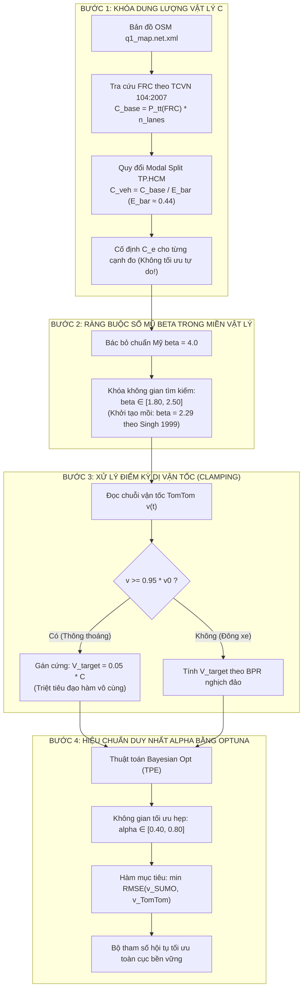

# CƠ SỞ TOÁN HỌC VÀ PHÂN TÍCH ĐỘ NHẠY HÀM BPR NGHỊCH ĐẢO TRONG MÔ HÌNH HÓA DÒNG XE HỖN HỢP
## (MATHEMATICAL SENSITIVITY ANALYSIS & PARAMETER COUPLING OF INVERTED BPR FUNCTION FOR HETEROGENEOUS URBAN TRAFFIC)

> **Tài liệu Kỹ thuật Nền tảng & Cơ sở Phương pháp luận**  
> **Dự án:** Điều khiển Đèn Giao thông Thích ứng bằng Học tăng cường Đa tác tử (MARL-TSC)  
> **Khu vực nghiên cứu:** Trung tâm Quận 1 & Quận 3, TP. Hồ Chí Minh (66 cạnh đo trọng yếu)  
> **Mục tiêu:** Cung cấp chứng minh giải tích toán học về độ nhạy (Sensitivity) và độ co giãn (Elasticity) của các tham số $(C, \alpha, \beta)$ trong hàm BPR nghịch đảo; xếp hạng mức độ ảnh hưởng và thiết lập quy trình tách biến (Decoupled Optimization) để tìm bộ tham số tối ưu mà không làm bùng nổ sai số.

---

## MỤC LỤC
1. [Đặt vấn đề & Khung toán học Hàm BPR Nghịch đảo](#1-đặt-vấn-đề--khung-toán-học-hàm-bpr-nghịch-đảo)
2. [Chứng minh Giải tích Đạo hàm & Độ co giãn của từng Đại lượng](#2-chứng-minh-giải-tích-đạo-hàm--độ-co-giãn-của-từng-đại-lượng)
   * 2.1. Phân tích Dung lượng đường $C$ (Capacity): Tuyến tính bậc 1 ($\mathcal{E}_C = 1.0$)
   * 2.2. Phân tích Hệ số trễ cận biên $\alpha$ (Alpha): Kém co giãn ($|\mathcal{E}_\alpha| < 1.0$)
   * 2.3. Phân tích Số mũ độ dốc quá tải $\beta$ (Beta): Phi tuyến mũ & Đổi chiều phản ứng
   * 2.4. Phân tích Biến quan trắc Vận tốc $v$ (TomTom Speed) & Điểm kỳ dị tiệm cận $v \to v_0$
3. [Bảng Tổng hợp Xếp hạng Mức độ Ảnh hưởng của các Tham số](#3-bảng-tổng-hợp-xếp-hạng-mức-độ-ảnh-hưởng-của-các-tham-số)
4. [Ý nghĩa Vật lý đối với Dòng xe máy Hỗn hợp TP. Hồ Chí Minh](#4-ý-nghĩa-vật-lý-đối-với-dòng-xe-máy-hỗn-hợp-tp-hồ-chí-minh)
5. [Chiến lược 4 Bước Tách biến để Hiệu chuẩn Tham số (Decoupled Optimization Workflow)](#5-chiến-lược-4-bước-tách-biến-để-hiệu-chuẩn-tham-số-decoupled-optimization-workflow)
6. [Mã Giả Triển khai Thuật toán & Giao diện Python Mẫu](#6-mã-giả-triển-khai-thuật-toán--giao-diện-python-mẫu)
7. [Danh mục Tài liệu Tham khảo & Mã BibTeX](#7-danh-mục-tài-liệu-tham-khảo--mã-bibtex)

---

## 1. ĐẶT VẤN ĐỀ & KHUNG TOÁN HỌC HÀM BPR NGHỊCH ĐẢO

Trong các bài toán giao thông đô thị hiện đại khi thiếu hệ thống vòng từ cảm ứng (Induction Loop Detectors) cố định, dữ liệu vận tốc hành trình vệ tinh (Probe Vehicle Data như TomTom, Google Maps) là nguồn thông tin liên tục và bao phủ rộng nhất. Để chuyển đổi vận tốc đo đạc thành nhu cầu lưu lượng xe $V$ (Volume) nạp vào mô phỏng vi mô SUMO, hàm trở kháng của Cục Đường bộ Mỹ (Bureau of Public Roads - BPR, 1964) [1] được sử dụng theo chiều nghịch đảo.

### 1.1. Phương trình BPR thuận
Phương trình liên hệ giữa vận tốc lưu thông trung bình $v$ và lưu lượng $V$:

$$v = \frac{v_0}{1 + \alpha \left( \frac{V}{C} \right)^\beta}$$

*Trong đó:*
* $v$: Vận tốc lưu thông thực tế trên đoạn đường $[\text{km/h}]$.
* $v_0$: Vận tốc dòng tự do (Free-flow speed) $[\text{km/h}]$.
* $C$: Dung lượng thiết kế thông hành của đoạn đường $[\text{PCU/h}]$.
* $\alpha$: Hệ số trễ cận biên (định thời điểm bắt đầu giảm tốc).
* $\beta$: Số mũ xác định độ dốc sụt giảm vận tốc khi dòng xe bị quá tải.

### 1.2. Dẫn xuất Phương trình BPR nghịch đảo
Giả định đoạn đường đang ở trạng thái có dòng xe di chuyển và vận tốc thực tế không vượt quá vận tốc tự do ($v \le v_0$). Biến đổi đại số:

$$\frac{v_0}{v} = 1 + \alpha \left( \frac{V}{C} \right)^\beta \iff \alpha \left( \frac{V}{C} \right)^\beta = \frac{v_0 - v}{v}$$

$$\left( \frac{V}{C} \right)^\beta = \frac{1}{\alpha} \left( \frac{v_0 - v}{v} \right) = \frac{1}{\alpha} \left( \frac{v_0}{v} - 1 \right)$$

Lấy lũy thừa bậc $1/\beta$ hai vế:

$$\frac{V}{C} = \left[ \frac{1}{\alpha} \left( \frac{v_0 - v}{v} \right) \right]^{1/\beta}$$

Đặt đại lượng không thứ nguyên:
$$X = \frac{v_0 - v}{v} = \frac{v_0}{v} - 1 \ge 0$$
$X$ đại diện cho **tỷ lệ suy giảm vận tốc tương đối** (hay tỷ lệ độ trễ tương đối do ùn tắc).

Ta thu được công thức tổng quát của **Hàm BPR nghịch đảo**:

$$V(C, \alpha, \beta; v, v_0) = C \cdot \left( \frac{X}{\alpha} \right)^{1/\beta} = C \cdot \alpha^{-1/\beta} \cdot \left( \frac{v_0 - v}{v} \right)^{1/\beta}$$

---

## 2. CHỨNG MINH GIẢI TÍCH ĐẠO HÀM & ĐỘ CO GIÃN CỦA TỪNG ĐẠI LƯỢNG

Để phân định rạch ròi đại lượng nào ảnh hưởng nhiều hay ít, ta xét khái niệm **Độ co giãn cục bộ (Point Elasticity $\mathcal{E}$)**.  
Độ co giãn $\mathcal{E}_p$ đo lường: **Khi tham số $p$ tăng $1\%$ thì lưu lượng $V$ sẽ thay đổi bao nhiêu $\%$**:

$$\mathcal{E}_p = \frac{\partial V / V}{\partial p / p} = \frac{\partial V}{\partial p} \cdot \frac{p}{V} = \frac{\partial \ln V}{\partial \ln p}$$

Lấy logarit tự nhiên hai vế của hàm BPR nghịch đảo:
$$\ln V = \ln C - \frac{1}{\beta} \ln \alpha + \frac{1}{\beta} \ln \left( \frac{v_0 - v}{v} \right)$$

---

### 2.1. Phân tích Dung lượng đường $C$ (Capacity)
Lấy đạo hàm riêng của $\ln V$ theo $\ln C$:

$$\mathcal{E}_C = \frac{\partial \ln V}{\partial \ln C} = \mathbf{1.0}$$

Hoặc lấy đạo hàm riêng trực tiếp:
$$\frac{\partial V}{\partial C} = \left( \frac{X}{\alpha} \right)^{1/\beta} = \frac{V}{C} > 0 \implies \mathcal{E}_C = \frac{\partial V}{\partial C} \cdot \frac{C}{V} = \frac{V}{C} \cdot \frac{C}{V} = \mathbf{1.0}$$

#### Nhận xét Toán học & Hệ quả Kỹ thuật:
1. **Tính tuyến tính tuyệt đối bậc 1:** Độ co giãn $\mathcal{E}_C = 1.0$ là hằng số bất biến ở mọi dải vận tốc và mọi trạng thái giao thông.
2. **Quy luật phản ứng:**  
   * Nếu $C$ tăng $+10\%$, lưu lượng $V$ tăng chính xác $+10\%$.
   * Nếu $C$ giảm $-20\%$, lưu lượng $V$ giảm đúng $-20\%$.
3. **Ý nghĩa thực tế:** $C$ đóng vai trò là **Hệ số tỷ lệ quy mô toàn cục (Global Scale Multiplier)**. Sai số ước tính $C$ không làm méo mó hình dạng đường cong BPR, nhưng sẽ làm sai lệch toàn bộ quy mô lưu lượng nạp mạng, ảnh hưởng trực tiếp đến hệ số độ dốc (Slope $s$) khi đối chuẩn toàn mạng.

---

### 2.2. Phân tích Hệ số trễ cận biên $\alpha$ (Alpha - Ratio Multiplier)
Lấy đạo hàm riêng của $\ln V$ theo $\ln \alpha$:

$$\mathcal{E}_\alpha = \frac{\partial \ln V}{\partial \ln \alpha} = \mathbf{-\frac{1}{\beta}}$$

Hoặc lấy đạo hàm trực tiếp theo $\alpha$:
$$\frac{\partial V}{\partial \alpha} = C \cdot X^{1/\beta} \cdot \left( -\frac{1}{\beta} \right) \alpha^{-\frac{1}{\beta} - 1} = -\frac{1}{\beta \cdot \alpha} V < 0$$
$$\implies \mathcal{E}_\alpha = \left( -\frac{1}{\beta \cdot \alpha} V \right) \cdot \frac{\alpha}{V} = \mathbf{-\frac{1}{\beta}}$$

#### Nhận xét Toán học & Hệ quả Kỹ thuật:
1. **Tính chất Kém co giãn (Inelasticity):**  
   Đối với mọi dòng giao thông thực tế, số mũ $\beta$ luôn lớn hơn $1.0$ ($\beta \in [1.5, 4.0]$). Do đó:
   $$|\mathcal{E}_\alpha| = \frac{1}{\beta} < 1.0$$
2. **Quy luật phản ứng:**  
   * Với chuẩn Mỹ ($\beta = 4.0$): $|\mathcal{E}_\alpha| = 1/4 = 0.25$. Khi $\alpha$ tăng $+10\%$, lưu lượng $V$ chỉ giảm $-2.5\%$.
   * Với chuẩn xe máy Singh (1999) ($\beta = 2.29$): $|\mathcal{E}_\alpha| = 1/2.29 \approx 0.437$. Khi $\alpha$ tăng $+10\%$, $V$ chỉ giảm $-4.37\%$.
   * Ngay cả ở mức số mũ mềm $\beta = 1.5$: $|\mathcal{E}_\alpha| = 0.67 < 1.0$.
3. **Ý nghĩa thực tế:** **$\alpha$ là tham số có mức độ ảnh hưởng YẾU NHẤT trong 3 tham số.** Sự thay đổi của $\alpha$ bị số mũ $\beta$ nén lại theo lũy thừa nghịch đảo. Do đó, việc thay đổi $\alpha$ trong một biên độ vừa phải không bao giờ gây ra hiện tượng sụp đổ hoặc bùng nổ dữ liệu lưu lượng.

---

### 2.3. Phân tích Số mũ độ dốc quá tải $\beta$ (Beta - Power Exponent)
Viết lại hàm $V$ dưới dạng hàm mũ:
$$V = C \cdot \exp \left( \frac{1}{\beta} \ln \left( \frac{X}{\alpha} \right) \right)$$

Lấy đạo hàm riêng theo $\beta$:
$$\frac{\partial V}{\partial \beta} = V \cdot \left[ -\frac{1}{\beta^2} \ln \left( \frac{X}{\alpha} \right) \right]$$

Vì từ phương trình ban đầu, $\left(\frac{X}{\alpha}\right)^{1/\beta} = \frac{V}{C} \implies \ln \left( \frac{X}{\alpha} \right) = \beta \ln \left( \frac{V}{C} \right)$. Thay vào biểu thức đạo hàm:
$$\frac{\partial V}{\partial \beta} = -\frac{V}{\beta} \ln \left( \frac{V}{C} \right)$$

Độ co giãn theo $\beta$ ($\mathcal{E}_\beta$):
$$\mathcal{E}_\beta = \frac{\partial V}{\partial \beta} \cdot \frac{\beta}{V} = \mathbf{-\frac{1}{\beta} \ln \left( \frac{V}{C} \right)}$$

#### Nhận xét Toán học & Hệ quả Kỹ thuật:
1. **Tính chất Đổi chiều Phi tuyến (Nonlinear Sign Inversion):**  
   Dấu và độ lớn của $\mathcal{E}_\beta$ phụ thuộc trực tiếp vào trạng thái bão hòa của dòng đường ($V/C$):
   * **Vùng thấp điểm / Bán bão hòa ($V < C \iff V/C < 1$):**  
     $\ln(V/C) < 0 \implies \mathcal{E}_\beta > 0$: **Khi $\beta$ tăng, lưu lượng tính toán $V$ TĂNG**.
   * **Vùng bão hòa danh định ($V = C \iff V/C = 1$):**  
     $\ln(V/C) = 0 \implies \mathcal{E}_\beta = 0$: **Tại đúng điểm bão hòa, $\beta$ hoàn toàn KHÔNG CÓ ẢNH HƯỞNG đến $V$!**
   * **Vùng quá tải / Giờ cao điểm tắc nghẽn ($V > C \iff V/C > 1$):**  
     $\ln(V/C) > 0 \implies \mathcal{E}_\beta < 0$: **Khi $\beta$ tăng, lưu lượng tính toán $V$ GIẢM RẤT MẠNH**.
2. **Hiệu ứng số mũ bùng nổ (Exponential Divergence):**  
   Vì $\beta$ nằm ở số mũ nghịch đảo $1/\beta$, khi tỷ số vận tốc $(v_0 - v)/v$ lệch xa $1.0$, sự biến thiên của $\beta$ sẽ làm $V$ co giãn theo cấp số nhân.
3. **Ý nghĩa thực tế:** **$\beta$ là tham số NHẠY CẢM NHẤT VÀ NGUY HIỂM NHẤT.** Nếu chọn sai $\beta$, mô hình sẽ bị phân kỳ: vào giờ cao điểm, $\beta$ quá cao sẽ dập tắt lưu lượng, trong khi vào giờ thấp điểm lại đẩy lưu lượng lên cao phi lý.

---

### 2.4. Phân tích Biến quan trắc Vận tốc $v$ (TomTom Speed) & Điểm kỳ dị tiệm cận $v \to v_0$
Ngoài 3 tham số trên, cần khảo sát đạo hàm của $V$ đối với chính biến số đầu vào từ vệ tinh $v$:

$$\frac{\partial V}{\partial v} = C \alpha^{-1/\beta} \cdot \frac{1}{\beta} \left( \frac{v_0 - v}{v} \right)^{\frac{1}{\beta} - 1} \cdot \left( -\frac{v_0}{v^2} \right) = -\frac{V}{\beta} \left( \frac{v_0}{v(v_0 - v)} \right) < 0$$

Độ co giãn theo vận tốc $v$ ($\mathcal{E}_v$):
$$\mathcal{E}_v = \frac{\partial V}{\partial v} \cdot \frac{v}{V} = \mathbf{-\frac{1}{\beta} \left( \frac{v_0}{v_0 - v} \right)}$$

#### Phân tích Điểm kỳ dị (Singularity Analysis):
* Khi đường rất vắng (đêm khuya hoặc giữa trưa thông thoáng), vận tốc thực tế tiệm cận vận tốc tự do:
  $$v \to v_0 \implies (v_0 - v) \to 0 \implies \lim_{v \to v_0} \mathcal{E}_v = -\infty$$
* **Hệ quả thực tế khốc liệt:**  
  Tại vùng $v \approx v_0$, mẫu số triệt tiêu khiến độ nhạy tiến tới vô cùng. Một dao động GPS nhỏ của TomTom (ví dụ vận tốc đổi từ $29.5 \to 28.5\text{ km/h}$, chỉ lệch $1\text{ km/h}$) cũng khiến lưu lượng $V$ nhảy vọt từ vài chục xe lên hàng nghìn xe. Đây chính là nguyên nhân gốc rễ gây nhiễu loạn lưu lượng nạp mạng!

---

## 3. BẢNG TỔNG HỢP XẾP HẠNG MỨC ĐỘ ẢNH HƯỞNG CỦA CÁC THAM SỐ

| Tham số | Vị trí trong Phương trình | Biểu thức Độ co giãn ($\mathcal{E}$) | Đặc tính Toán học | Mức độ Ảnh hưởng | Chiến lược Ứng xử Kỹ thuật |
| :---: | :---: | :---: | :--- | :---: | :--- |
| **$\mathbf{\beta}$<br>(Số mũ)** | Nằm ở lũy thừa nghịch đảo: $(\cdot)^{1/\beta}$ | $\mathcal{E}_\beta = -\frac{1}{\beta}\ln\left(\frac{V}{C}\right)$ | **Phi tuyến mũ cực mạnh.** Đổi dấu phản ứng giữa giờ thấp điểm ($+$) và cao điểm ($-$). | 🥇 **HẠNG 1<br>(ẢNH HƯỞNG LỚN NHẤT & RỦI RO CAO NHẤT)** | **Không tối ưu tự do rộng.** Bắt buộc khoanh vùng vật lý hẹp dựa trên thực nghiệm dòng xe hỗn hợp: $\beta \in [1.8, 2.5]$. |
| **$\mathbf{C}$<br>(Dung lượng)** | Nhân trực tiếp bên ngoài: $C \times (\cdot)$ | $\mathcal{E}_C = 1.0$ *(Hằng số)* | **Tuyến tính tuyệt đối bậc 1.** Lệch $1\%$ dẫn tới lệch đúng $1\%$ lưu lượng toàn mạng. | 🥈 **HẠNG 2<br>(ẢNH HƯỞNG HỆ THỐNG TOÀN CỤC)** | **Xác định từ quy chuẩn hình học** (TCVN 104:2007 + Modal Split). Tuyệt đối không dùng thuật toán AI để "học mò" $C$. |
| **$\mathbf{\alpha}$<br>(Hệ số trễ)** | Nằm trong căn thức: $(1/\alpha)^{1/\beta}$ | $\mathcal{E}_\alpha = -\frac{1}{\beta}$ | **Kém co giãn (Inelastic).** Luôn có $|\mathcal{E}_\alpha| < 1$, biến thiên dưới tuyến tính, rất êm dịu. | 🥉 **HẠNG 3<br>(ẢNH HƯỞNG ÍT NHẤT)** | **Dùng thuật toán (Optuna / Bayesian Opt) để tinh chỉnh** trong dải $[0.4, 0.8]$ sau khi đã khóa $C$ và $\beta$. |
| **$\mathbf{v}$<br>(Vận tốc đo)** | Nằm trong phân thức: $\left(\frac{v_0 - v}{v}\right)^{1/\beta}$ | $\mathcal{E}_v = -\frac{1}{\beta}\left(\frac{v_0}{v_0 - v}\right)$ | **Điểm kỳ dị (Singularity).** Khi $v \to v_0$, độ nhạy bùng nổ vô hạn ($\mathcal{E}_v \to -\infty$). | ⚠️ **NGUỒN NHIỄU SƠ CẤP NGUY HIỂM** | **Áp dụng kỹ thuật Cắt ngưỡng (Boundary Clamping)**: Khi $v \ge 0.95 v_0$, gán cứng $V = 0.05 \cdot C$. |

---

## 4. Ý NGHĨA VẬT LÝ ĐỐI VỚI DÒNG XE MÁY HỖN HỢP TP. HỒ CHÍ MINH

Từ bảng phân tích trên, ta lý giải được vì sao việc áp dụng máy móc thông số của Mỹ ($\alpha=0.15, \beta=4.0$) thất bại hoàn toàn tại TP.HCM:

### 4.1. Tại sao $\beta = 4.0$ (Mỹ) phá hủy mô phỏng giao thông Quận 1?
* Ở phương Tây, dòng xe thuần túy là ô tô tuân thủ làn cứng. Khi $V/C > 1$, làn đường bị tắc nghẽn hoàn toàn, khoảng cách xe co về 0, tốc độ sụt giảm dốc đứng như một bức tường $\implies$ phù hợp với số mũ dốc đứng $\beta = 4.0$.
* Tại TP.HCM, xe máy chiếm $>85\%$ với đặc tính **thẩm thấu qua khe hở (Motorcycle Seepage / Porosity)**. Khi đường quá tải ($V/C = 1.2 - 1.5$), ô tô dừng lại nhưng xe máy vẫn lách qua các khoảng trống bên hông để duy trì tốc độ di chuyển chậm ($8 - 12\text{ km/h}$). Đường cong vận tốc không bao giờ bị rơi thẳng đứng mà thoai thoải kéo dài.
* Nếu ép $\beta = 4.0$ vào hàm BPR nghịch đảo: Tại vận tốc giờ cao điểm $v = 10\text{ km/h}$, số mũ $1/4 = 0.25$ làm lưu lượng tính toán bị dìm xuống mức thấp phi lý, khiến mô hình báo cáo thiếu hụt xe trầm trọng.
* **Kết luận vật lý:** Số mũ $\beta$ cho TP.HCM bắt buộc phải nằm trong khoảng **$\beta \in [1.80, 2.50]$**, phù hợp với nghiên cứu của Singh (1999) [2] ($\beta = 2.29$) và Kumar & Rao (2013) [3] ($\beta = 2.04$).

### 4.2. Tại sao $\alpha = 0.15$ (Mỹ) không phù hợp với Quận 1?
* Hệ số $\alpha = 0.15$ giả định rằng đường phải đông gần kín ($V/C > 0.75$) thì tốc độ mới bắt đầu giảm.
* Tại Quận 1, hiện tượng **ma sát bên (Side Friction)** rất cao: xe máy chuyển làn liên tục, hàng quán ven đường, taxi/Grab dừng đỗ đón trả khách. Vận tốc xe bị kéo giảm rất sớm, ngay từ khi lưu lượng mới đạt $V/C \approx 0.40 - 0.50$.
* Do đó, $\alpha$ của TP.HCM phải tăng cao lên khoảng **$\alpha \in [0.50, 0.70]$**. Vì $\alpha$ kém co giãn ($|\mathcal{E}_\alpha| \approx 0.43$), việc tinh chỉnh $\alpha$ trong dải này sẽ giúp đường cong dịch chuyển mượt mà mà không làm vỡ quy mô lưu lượng.

---

## 5. CHIẾN LƯỢC 4 BƯỚC TÁCH BIẾN ĐỂ HIỆU CHUẨN THAM SỐ (DECOUPLED OPTIMIZATION WORKFLOW)

Thay vì ném toàn bộ $(\alpha, \beta, C)$ vào một thuật toán hộp đen (Black-box Optimization) dẫn tới hiện tượng quá khớp (Overfitting) hoặc lạc vào cực tiểu cục bộ phi lý, quy trình khoa học chuẩn mực phải thực hiện theo **4 bước tách biến**:



---

## 6. MÃ GIẢ TRIỂN KHAI THUẬT TOÁN & GIAO DIỆN PYTHON MẪU

Dưới đây là đoạn mã nguồn Python chuẩn hóa triển khai chính xác phương pháp luận trên, có thể tích hợp trực tiếp vào module crawler và calibration của dự án:

```python
"""
bpr_inverted_calculator.py
Triển khai hàm BPR nghịch đảo có xử lý điểm kỳ dị và tách biến độ nhạy.
"""

import numpy as np
from typing import Union


def calculate_inverted_bpr_flow(
    speed_current: Union[float, np.ndarray],
    speed_freeflow: Union[float, np.ndarray],
    capacity_pcu_per_hour: Union[float, np.ndarray],
    alpha: float = 0.61,
    beta: float = 2.29,
    clamp_ratio: float = 0.95,
    minimum_flow_ratio: float = 0.05
) -> Union[float, np.ndarray]:
    """
    Tính lưu lượng mục tiêu V_target từ vận tốc đo đạc qua hàm BPR nghịch đảo.

    Công thức:
        V = C * [ (1 / alpha) * (v0 / v - 1) ]^(1 / beta)

    Kỹ thuật triệt tiêu điểm kỳ dị (Boundary Clamping):
        Nếu v >= clamp_ratio * v0: Gán V = minimum_flow_ratio * C.
    """
    # Đảm bảo đầu vào dạng mảng numpy để tính toán véc-tơ hóa
    v = np.asarray(speed_current, dtype=np.float64)
    v0 = np.asarray(speed_freeflow, dtype=np.float64)
    C = np.asarray(capacity_pcu_per_hour, dtype=np.float64)

    # 1. Tránh chia cho 0 khi kẹt xe hoàn toàn (v -> 0)
    v_safe = np.maximum(v, 1.0)  # Vận tốc tối thiểu 1.0 km/h
    v0_safe = np.maximum(v0, v_safe)

    # 2. Xử lý điểm kỳ dị khi đường thông thoáng (v >= 0.95 * v0)
    freeflow_mask = (v >= clamp_ratio * v0_safe)

    # 3. Tính tỷ lệ suy giảm vận tốc tương đối: X = (v0 / v) - 1
    rel_speed_drop = (v0_safe / v_safe) - 1.0
    rel_speed_drop = np.maximum(rel_speed_drop, 0.0)

    # 4. Tính BPR nghịch đảo: V = C * (X / alpha)^(1 / beta)
    inner_term = rel_speed_drop / max(alpha, 1e-4)
    flow_calculated = C * np.power(inner_term, (1.0 / beta))

    # 5. Áp dụng gán dòng nền tối thiểu cho các điểm tiệm cận tự do
    flow_target = np.where(freeflow_mask, minimum_flow_ratio * C, flow_calculated)

    return flow_target if not np.isscalar(speed_current) else float(flow_target)
```

---

## 7. DANH MỤC TÀI LIỆU THAM KHẢO & MÃ BIBTEX

### 7.1. Tài liệu Trích dẫn Chuẩn Quốc tế
1. **Bureau of Public Roads (BPR) (1964).** *Traffic Assignment Manual*. U.S. Department of Commerce, Urban Planning Division, Washington, D.C.
2. **Singh, R. (1999).** "Improved speed-flow relationships for congested travel on freeways and arterials in developing cities." *Transportation Research Record*, 1678(1), pp. 170–176.
3. **Kumar, P. K. H., & Rao, K. V. R. (2013).** "Calibration of speed flow relationship for mixed traffic conditions." *Journal of the Indian Roads Congress*, 74(3), pp. 273–284.
4. **Bộ Khoa học và Công nghệ (2007).** *Tiêu chuẩn Quốc gia TCVN 104:2007: Đường đô thị - Yêu cầu thiết kế*. NXB Xây dựng, Hà Nội.
5. **Akiba, T., Sano, S., Yanase, T., Ohta, T., & Koyama, M. (2019).** "Optuna: A next-generation hyperparameter optimization framework." *Proceedings of the 25th ACM SIGKDD International Conference on Knowledge Discovery & Data Mining (KDD 2019)*, pp. 2623–2631.
6. **Federal Highway Administration (FHWA) (2004).** *Traffic Analysis Toolbox Volume III: Guidelines for Applying Traffic Microsimulation Modeling Software*. Publication No. FHWA-HRT-04-040, U.S. Department of Transportation.

---

### 7.2. Khối BibTeX phục vụ Overleaf / LaTeX Khóa luận

```bibtex
@techreport{bpr1964traffic,
  author      = {{Bureau of Public Roads}},
  title       = {Traffic Assignment Manual},
  institution = {U.S. Department of Commerce, Urban Planning Division},
  year        = {1964},
  address     = {Washington, D.C.}
}

@article{singh1999improved,
  author    = {Singh, Ravindra},
  title     = {Improved speed-flow relationships for congested travel on freeways and arterials in developing cities},
  journal   = {Transportation Research Record},
  volume    = {1678},
  number    = {1},
  pages     = {170--176},
  year      = {1999},
  publisher = {SAGE Publications}
}

@article{kumar2013calibration,
  author    = {Kumar, P. K. H. and Rao, K. V. R.},
  title     = {Calibration of speed flow relationship for mixed traffic conditions},
  journal   = {Journal of the Indian Roads Congress},
  volume    = {74},
  number    = {3},
  pages     = {273--284},
  year      = {2013}
}

@standard{tcvn104_2007,
  title        = {TCVN 104:2007 - Urban roads: Design requirements},
  organization = {Ministry of Science and Technology of Vietnam},
  year         = {2007},
  address      = {Hanoi, Vietnam}
}

@inproceedings{akiba2019optuna,
  author    = {Akiba, Takuya and Sano, Shotaro and Yanase, Toshihiko and Ohta, Takeru and Koyama, Masanori},
  title     = {Optuna: A Next-generation Hyperparameter Optimization Framework},
  booktitle = {Proceedings of the 25th ACM SIGKDD International Conference on Knowledge Discovery \& Data Mining (KDD 2019)},
  pages     = {2623--2631},
  year      = {2019}
}
```
