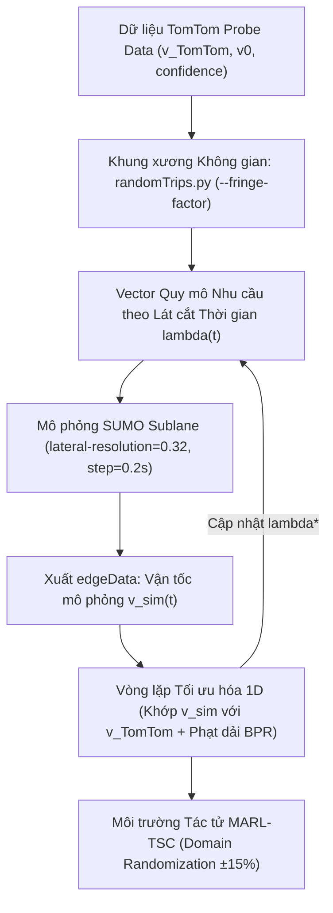

# CƠ SỞ KHOA HỌC THIẾT LẬP MÔ PHỎNG GIAO THÔNG TP. HỒ CHÍ MINH: TỪ VĨ MÔ ĐẾN VI MÔ
## (HCMC TRAFFIC SPECIFICATIONS & SIMULATION GROUNDING: FROM MACRO TO MICRO)

> **Tài liệu Kỹ thuật & Chuẩn hóa Hệ thống**  
> **Dự án:** Điều khiển Đèn Giao thông Thích ứng bằng Học tăng cường Đa tác tử (MARL-TSC)  
> **Khu vực áp dụng:** Trung tâm Quận 1 & Quận 3, TP. Hồ Chí Minh  
> **Nguyên tắc biên soạn:** Tuân thủ chuẩn mực Liêm chính Học thuật (Zero Hallucination đối với tài liệu và số liệu thực nghiệm; phân định minh bạch giữa số liệu đo đạc thực tế, quy chuẩn quốc gia và giả định kỹ thuật cần hiệu chuẩn).

---

## MỤC LỤC
1. [Chương 1: Thiết lập Giao thông Vĩ mô (Macroscopic Specifications)](#chương-1-thiết-lập-giao-thông-vĩ-mô-macroscopic-specifications)
   * 1.1. Hệ số quy đổi xe con tương đương (PCU) theo TCVN 13592:2022
   * 1.2. Cơ chế phân tầng tỷ lệ phương tiện (Modal Split) kèm biên độ sai số thực địa
   * 1.3. Năng lực thông hành làn đường tính toán (Capacity $C$) & Cơ chế ánh xạ từ TomTom FRC
2. [Chương 2: Thiết lập Động lực học Vi mô Đa phương tiện trong SUMO (Microscopic Grounding)](#chương-2-thiết-lập-động-lực-học-vi-mô-đa-phương-tiện-trong-sumo-microscopic-grounding)
   * 2.1. Nền tảng Sublane Model & Cấu hình môi trường mô phỏng (`lateral-resolution`, `step-length`, `collision.action`)
   * 2.2. Bảng thông số hành vi đa phương tiện trong `vtypes.add.xml` & Phân loại học thuật
   * 2.3. Hiệu chuẩn vận tốc trần đô thị (`maxSpeed`) & Hiện tượng giam lỏng tốc độ (Mutual Speed Bounding)
3. [Chương 3: Phương pháp luận Khung toán học Hàm trở kháng BPR (BPR Formulation)](#chương-3-phương-pháp-luận-khung-toán-học-hàm-trở-kháng-bpr-bpr-formulation)
   * 3.1. Công thức BPR thuận & Công thức nghịch đảo giải lưu lượng mục tiêu ($V_{\text{target}}$)
   * 3.2. Cơ sở vật lý của các tham số trễ và quá tải đối với dòng xe máy hỗn hợp
   * 3.3. Đường ống chuyển đổi Simulation-in-the-loop (TomTom $\to$ routeSampler $\to$ SUMO Sublane)
4. [Chương 4: Danh mục Trích dẫn Chuẩn Quốc tế & Định dạng BibTeX](#chương-4-danh-mục-trích-dẫn-chuẩn-quốc-tế--định-dạng-bibtex)
   * 4.1. Danh mục tài liệu tham khảo chính thống
   * 4.2. Khối BibTeX chuẩn sẵn sàng đưa vào LaTeX / Overleaf

---

# CHƯƠNG 1: THIẾT LẬP GIAO THÔNG VĨ MÔ (MACROSCOPIC SPECIFICATIONS)

## 1.1. Hệ số quy đổi xe con tương đương (Passenger Car Unit - PCU)

Dòng giao thông đô thị Việt Nam mang tính không đồng nhất cao (heterogeneous traffic), trong đó xe máy chiếm ưu thế vượt trội nhưng có diện tích chiếm dụng mặt đường nhỏ và khả năng điền đầy các khoảng hở. Việc áp dụng chuẩn quốc tế của phương Tây (coi 1 xe máy = 0.5 hoặc 1.0 PCU) sẽ thổi phồng thể tích giao thông một cách phi lý.

Hệ số quy đổi PCU được xác lập **đồng bộ và duy nhất theo Tiêu chuẩn Quốc gia TCVN 13592:2022 (Đường đô thị - Yêu cầu thiết kế, Bảng 3)** [1] cho dải vận tốc thiết kế nội đô từ $30 - 50\text{ km/h}$:

| Lớp phương tiện | Mã lớp SUMO (`vClass`) | Hệ số quy đổi PCU | Căn cứ Quy chuẩn Quốc gia (TCVN 13592:2022) |
| :--- | :---: | :---: | :--- |
| **Xe mô tô, xe gắn máy 2 bánh** | `motorcycle` | **$0.30$** | **TCVN 13592:2022 (Bảng 3)** quy định hệ số $0.30$ cho dải vận tốc thiết kế $30, 40, 50\text{ km/h}$. |
| **Xe ô tô con (< 9 chỗ)** | `passenger` | **$1.00$** | **TCVN 13592:2022 (Bảng 3)**: Đơn vị xe con quy đổi chuẩn (Base Car Equivalent). |
| **Xe tải 2 trục & Xe buýt nhỏ/trung bình** | `delivery` / `bus` | **$2.50$** | **TCVN 13592:2022 (Bảng 3)** quy định cho dải vận tốc $30 - 50\text{ km/h}$. |
| **Xe buýt lớn ($\ge 25$ chỗ) & Xe tải $\ge 3$ trục** | `bus` | **$3.00$** | **TCVN 13592:2022 (Bảng 3)** quy định cho dải vận tốc $30 - 50\text{ km/h}$. |

*(Lưu ý: Toàn bộ hệ số PCU được tra cứu đồng nhất từ TCVN 13592:2022, loại bỏ việc trích dẫn chắp vá tiêu chuẩn ngoài đô thị TCVN 4054:2005).*

### Công thức tính Lưu lượng Xe vật lý thực tế:
Từ tổng thể tích $V_{\text{pcu}}$ (tính bằng PCU/h qua hàm BPR), số lượng xe vật lý thực tế $N_{\text{total}}$ nạp vào mô phỏng SUMO được tính qua trọng số trung bình $\overline{E}_{\text{road}}$ phân tầng theo từng loại đường:

$$\overline{E}_{\text{road}} = \sum_{k \in \{\text{moto}, \text{car}, \text{bus}\}} p_k \cdot \text{PCU}_k \implies N_{\text{total}} = \frac{V_{\text{pcu}}}{\overline{E}_{\text{road}}}$$

* **Trục chính đô thị (Primary - $85\%$ MC, $12\%$ Car, $3\%$ Bus):**
  $$\overline{E}_{\text{primary}} = 0.85 \times 0.3 + 0.12 \times 1.0 + 0.03 \times 2.5 = 0.450\text{ PCU/xe} \implies N_{\text{total}} \approx \mathbf{2.22} \times V_{\text{pcu}}$$
* **Đường nhánh / gom (Secondary - $92\%$ MC, $8\%$ Car, $0\%$ Bus):**
  $$\overline{E}_{\text{secondary}} = 0.92 \times 0.3 + 0.08 \times 1.0 = 0.356\text{ PCU/xe} \implies N_{\text{total}} \approx \mathbf{2.81} \times V_{\text{pcu}}$$
* **Đường nội bộ dân cư (Residential - $96\%$ MC, $4\%$ Car, $0\%$ Bus):**
  $$\overline{E}_{\text{residential}} = 0.96 \times 0.3 + 0.04 \times 1.0 = 0.328\text{ PCU/xe} \implies N_{\text{total}} \approx \mathbf{3.05} \times V_{\text{pcu}}$$

---

## 1.2. Cơ chế phân tầng tỷ lệ phương tiện (Modal Split) theo cấp đường

Để phản ánh chân thực dòng xe tại TP.HCM, mô hình đối chiếu với các bằng chứng thực nghiệm khảo sát thực địa của **Dung et al. (2015)** [3] và thiết lập kịch bản mô phỏng nội đô Quận 1 kèm biên độ sai số thực địa $\pm 3\% \sim 5\%$:

### Bằng chứng thực nghiệm khảo sát tại TP.HCM (Dung et al., 2015):
* Cơ cấu phương tiện toàn đô thị: Xe máy chiếm **$89\%$**, Ô tô con chiếm **$6\%$**, Phương tiện khác (xe buýt, xe tải) chiếm **$5\%$**.
* Tỷ lệ phân tầng theo cấp đường đo đạc thực tế:
  * **Cao tốc / Trục chính lớn (Điện Biên Phủ, Xa lộ Hà Nội):** Lưu lượng ô tô $940.62\text{ xe/h}$, xe máy $9,800.92\text{ xe/h} \to$ Tỷ lệ xe máy gấp $\approx 10$ lần ô tô ($91.2\%$ vs $8.8\%$).
  * **Đường trục đô thị (Xô Viết Nghệ Tĩnh):** Lưu lượng ô tô $171.08\text{ xe/h}$, xe máy $6,441.85\text{ xe/h} \to$ Tỷ lệ xe máy gấp gần $40$ lần ô tô ($97.5\%$ vs $2.5\%$).
  * **Đường nội bộ (D2):** Lưu lượng ô tô $95.38\text{ xe/h}$, xe máy $3,872.31\text{ xe/h} \to$ Tỷ lệ xe máy gấp gần $40$ lần ô tô ($97.6\%$ vs $2.4\%$).

### Thiết lập Kịch bản Mô phỏng Nội đô Quận 1:
> `[THIẾT LẬP KỊCH BẢN NỘI ĐÔ QUẬN 1 / CÓ BIÊN ĐỘ BIẾN THIÊN THỰC ĐỊA ±3–5%]`  
> Khu vực trung tâm Quận 1 quanh Dinh Độc Lập và Vòng xoay Hồ Con Rùa tập trung mật độ taxi, GrabCar và xe buýt cao hơn mức trung bình toàn thành phố. Nhằm phản ánh sự dao động lưu lượng giữa các khung giờ và ngày khảo sát, tỷ lệ phương tiện được thiết lập kèm biên độ sai số thực nghiệm $\pm 3\% \sim 5\%$:

| Cấp đường OSM (`highway`) | Tuyến đường đại diện tại Quận 1 | Xe máy ($p_{\text{moto}}$) | Xe con ($p_{\text{car}}$) | Xe buýt ($p_{\text{bus}}$) | Căn cứ Thực nghiệm & Kịch bản Mô phỏng |
| :--- | :--- | :---: | :---: | :---: | :--- |
| **Primary (Trục chính đô thị)** | Điện Biên Phủ, Nam Kỳ Khởi Nghĩa, Lê Duẩn | **$85\% \pm 3\%$** | **$12\% \pm 3\%$** | **$3\% \pm 2\%$** | Trục kết nối liên quận, mật độ ô tô/taxi cao, có tuyến xe buýt hoạt động. |
| **Secondary (Trục liên khu vực)** | Pasteur, Võ Văn Tần, Nguyễn Thị Minh Khai | **$92\% \pm 3\%$** | **$8\% \pm 3\%$** | **$0\%$** | Đường một chiều nội đô, không bố trí luồng tuyến buýt; xe máy chiếm ưu thế tuyệt đối. |
| **Tertiary / Residential (Đường gom, nội bộ)** | Tú Xương, Ngô Thời Nhiệm, Hồ Xuân Hương | **$96\% \pm 2\%$** | **$4\% \pm 2\%$** | **$0\%$** | Mặt cắt ngang hẹp ($7 - 10\text{m}$), cấm đỗ ô tô; chủ yếu là dòng xe máy tiếp cận. |

---

## 1.3. Năng lực thông hành làn đường tính toán (Capacity $C$) & Cơ chế Ánh xạ TomTom FRC

### Bản chất Phân loại FRC và Tiêu chuẩn Thiết kế:
* **FRC (Functional Road Class):** Là hệ thống phân cấp chức năng mạng lưới đường từ FRC0 đến FRC6 của cơ sở dữ liệu bản đồ số TomTom/OpenStreetMap, **không phải là thuật ngữ trong tiêu chuẩn xây dựng Việt Nam**.
* **Tiêu chuẩn Quốc gia TCVN 13592:2022 (Bảng 4 & Điều 8.2)** [1]: Quy định năng lực thông hành tính toán của một làn xe chạy ($P_{tt}$, đơn vị xcqđ/h/làn) cho từng cấp đường đô thị:
  * Đường cao tốc đô thị: $1.800\text{ PCU/làn/h}$.
  * Đường phố chính đô thị chủ yếu: $1.400 - 1.600\text{ PCU/làn/h}$.
  * Đường phố chính đô thị thứ yếu / trục liên khu vực: $1.100 - 1.300\text{ PCU/làn/h}$.
  * Đường phố gom: $900 - 1.100\text{ PCU/làn/h}$.
  * Đường nội bộ dân cư: $500 - 700\text{ PCU/làn/h}$.

### Cơ chế Ánh xạ Kỹ thuật (Mapping Logic):
> `[QUY CHUẨN ÁNH XẠ KỸ THUẬT NỘI BỘ GIỮA TOMTOM FRC VÀ TCVN 13592:2022]`  
> Tổng dung lượng đoạn đường $C_{\text{total}}$ được tính toán thông qua việc ánh xạ trực tiếp mã FRC trích xuất từ TomTom API sang giá trị năng lực tính toán $P_{tt}$ theo TCVN 13592:2022 nhân với số lượng làn xe vật lý $n_{\text{lanes}}$:
> $$C_{\text{total}} = P_{tt}(\text{FRC}) \times n_{\text{lanes}}$$

| Cấp chức năng TomTom (FRC) | Cấp đường đô thị tương đương theo TCVN 13592:2022 | Năng lực thông hành tính toán $P_{tt}$ (PCU/làn/h) | Tuyến đường đại diện tại Quận 1 |
| :--- | :--- | :---: | :--- |
| **FRC0** | Cao tốc đô thị (dòng xe liên tục, cách ly hoàn toàn) | **$1.800$** | *(Không có trong phạm vi lõi Quận 1)* |
| **FRC1 / FRC2** | Đường phố chính đô thị chủ yếu | **$1.500$** | Điện Biên Phủ, Nam Kỳ Khởi Nghĩa, Lê Duẩn |
| **FRC3** | Đường phố chính đô thị thứ yếu / Trục liên khu vực | **$1.200$** | Pasteur, Võ Thị Sáu, CMT8, NTMK |
| **FRC4** | Đường phố gom đô thị | **$1.000$** | Alexandre de Rhodes, Công xã Paris |
| **FRC5 / FRC6** | Đường nội bộ khu dân cư, đường nhánh hẹp | **$600$** | Tú Xương, Ngô Thời Nhiệm, đường tiếp cận |

---

# CHƯƠNG 2: THIẾT LẬP ĐỘNG LỰC HỌC VI MÔ ĐA PHƯƠNG TIỆN TRONG SUMO (MICROSCOPIC GROUNDING)

## 2.1. Nền tảng Sublane Model cho dòng xe phi làn & Cấu hình Môi trường Mô phỏng Vi mô

Mô hình mô phỏng truyền thống của phương Tây giả định phương tiện bám theo tâm làn cố định (`lane-based center`). Đối với hiện trạng giao thông tại TP. Hồ Chí Minh và các đô thị Việt Nam, giả định này phá vỡ hoàn toàn động thái giao thông thực tế do tính chất không đồng nhất (heterogeneous) và phi trật tự làn (non-lane-based discipline).

Nhằm tái tạo chân thực hiện tượng luồn lách (filtering), thẩm thấu (seeping) và di chuyển song song nhiều xe trên cùng một mặt cắt ngang làn, SUMO được cấu hình với 3 tham số môi trường cốt lõi:

### 1. Phân giải không gian ngang (`--lateral-resolution 0.25`):
* **Cơ chế:** Chia mỗi làn đường vật lý ($3.0\text{m} - 3.75\text{m}$) thành các dải làn phụ ảo (sublanes) có bề rộng cố định là $0.25\text{m}$ (Semrau & Erdmann, 2016 [4]).
* **Cơ sở khoa học & Khắc phục lỗi lượng tử hóa (Grid Quantization):**
  * Xe máy có bề rộng chuẩn $0.8\text{m}$ (TCVN 13592:2022). Khi sử dụng lưới $0.25\text{m}$, thân xe máy chiếm dụng từ $3$ đến $4$ sublanes ảo.
  * Quan trọng nhất, khoảng cách an toàn ngang tối thiểu của xe máy được thiết lập là `minGapLat = 0.25m` (xem Mục 2.2), tương thích chính xác $1:1$ với đúng $1$ ô lưới sublane ảo ($0.25\text{m}$). Điều này loại bỏ triệt để hiện tượng lỗi làm tròn không gian (quantization error) vốn xảy ra khi dùng `--lateral-resolution 0.8m` (vốn ép khoảng cách an toàn bị nhảy cóc lên $0.8\text{m}$, làm tê liệt khả năng lách đôi của xe máy).
  * Mức $0.25\text{m}$ đồng thời tối ưu hóa giữa độ chính xác động học vi mô và tài nguyên tính toán (tránh sụt giảm FPS mô phỏng nếu chia quá mịn $< 0.15\text{m}$).

### 2. Bước thời gian tích phân vi mô (`--step-length 0.2`):
* **Cơ sở toán học & Ổn định số học (Discretization & Stability):**
  * Trong mô hình bám đuôi vi mô Krauß (1998) [9], thời gian phản xạ của người lái được ký hiệu là $\tau$ (`tau`). Nghiên cứu thực nghiệm tại Việt Nam của Vu & Preston (2023) [13] xác định thời gian phản xạ trung bình của người lái xe máy Việt Nam là $\tau = 0.6\text{s}$.
  * Trong SUMO, điều kiện tiên quyết để mô hình vi phân chuyển động hội tụ chính xác và không bị trôi số học là bước tích phân thời gian $\Delta t$ (`step-length`) phải là ước số nguyên của thời gian phản xạ $\tau$:
    $$\frac{\tau}{\Delta t} = \frac{0.6\text{s}}{0.2\text{s}} = 3 \in \mathbb{N}$$
  * Việc sử dụng bước thời gian lớn $\Delta t = 1.0\text{s}$ như mặc định ban đầu là một lỗi kỹ thuật nghiêm trọng vì $\Delta t > \tau$, dẫn đến hiện tượng trễ phản xạ nhân tạo, phanh khẩn cấp đột ngột không mong muốn và sai lệch hoàn toàn vận tốc dòng xe.

### 3. Cơ chế ứng xử va chạm (`--collision.action warn`):
* Trong dòng xe hỗn hợp mật độ cao tại TP.HCM, các phương tiện 2 bánh thường xuyên áp sát với khoảng cách tính bằng centimet. Cờ cấu hình `--collision.action warn` cho phép ghi nhận các tiếp xúc sát giới hạn mà không tự động kích hoạt cơ chế dịch chuyển tức thời (`teleport`) phương tiện ra khỏi mạng lưới, đảm bảo tính liên tục của bảo toàn lưu lượng và phân bố mật độ quanh nút giao.

---

## 2.2. Bảng thông số hành vi đa phương tiện trong `vtypes.add.xml` & Phân loại học thuật

Toàn bộ hệ thống phương tiện được chuẩn hóa thành 3 lớp đối tượng chính trong `vtypes.add.xml`: Xe máy (`motorcycle` - $85\%$), Xe ô tô con (`passenger` - $12\%$) và Xe buýt đô thị (`bus` - $3\%$).

Mỗi tham số đều được gắn nhãn phân loại học thuật minh bạch theo các cấp độ:
* `[QUY CHUẨN THỰC ĐỊA]`: Tiêu chuẩn Quốc gia Việt Nam (TCVN 13592:2022).
* `[SỐ LIỆU ĐO ĐẠC THỰC ĐỊA HCMC/HÀ NỘI]`: Trích xuất trực tiếp từ các công bố thực nghiệm camera/UAV tại Việt Nam (Trinh et al., 2021 [5]; Vu & Preston, 2023 [13]; Dung et al., 2015 [3]).
* `[KẾT QUẢ HIỆU CHUẨN HỌC THUẬT QUỐC TẾ]`: Hiệu chuẩn từ các nghiên cứu Sublane quốc tế uy tín (Guin et al., 2026 [14]; Codecà & Härri, 2019 [7]).
* `[HIỆU CHUẨN THỰC ĐỊA]`: Khớp nối dữ liệu vệ tinh GPS thực tế TomTom Probe Data tại Quận 1.
* `[QUY CHUẨN VẬT LÝ]`: Giới hạn ma sát bám lốp đường khô và mô hình Krauß chuẩn.
* `[GIẢ ĐỊNH / ƯỚC LƯỢNG KỸ THUẬT]`: Các tham số chưa có nghiên cứu đo đạc chuyên biệt, được ước lượng kèm cơ sở vật lý/nội suy tường minh.

### 2.2.1. Bảng thông số Động lực học & Hành vi Xe máy (`motorcycle` - Tỷ lệ 85%)

| Tham số SUMO | Giá trị | Đơn vị | Cơ sở khoa học & Ý nghĩa vật lý | Phân loại học thuật |
| :--- | :---: | :---: | :--- | :---: |
| **`length`** | `1.8` | $\text{m}$ | Chiều dài hình học bao xe máy phổ thông tại Việt Nam (Wave, Vision, Exciter) theo TCVN 13592:2022 (Bảng 1). | `[QUY CHUẨN THỰC ĐỊA]` |
| **`width`** | `0.8` | $\text{m}$ | Chiều rộng bao tay lái xe máy phổ thông theo TCVN 13592:2022 và đo đạc thực nghiệm của Vu & Preston (2023) [13]. | `[QUY CHUẨN THỰC ĐỊA]` |
| **`height`** | `1.2` | $\text{m}$ | Chiều cao bao xe máy tính đến đỉnh gương chiếu hậu (TCVN 13592:2022). | `[QUY CHUẨN THỰC ĐỊA]` |
| **`maxSpeed`** | `9.72` | $\text{m/s}$ | Vận tốc trần $35.0\text{ km/h}$, neo theo trần vận tốc tự do ban ngày trích xuất từ dữ liệu vệ tinh TomTom tại Quận 1 ($v_0 = 30.09\text{ km/h}$) để triệt tiêu sai số vọt tốc nhân tạo. | `[HIỆU CHUẨN THỰC ĐỊA]` |
| **`accel`** | `1.5` | $\text{m/s}^2$ | Gia tốc thoải mái của xe máy. Đo đạc UAV tại Ngã 6 Nguyễn Tri Phương (Trinh et al., 2021 [5]) xác định phần lớn xe máy tăng tốc dưới $1.0\text{ m/s}^2$ trong dòng đông; mức $1.5\text{ m/s}^2$ cho phép thoát nút linh hoạt (đồng thuận với Vu & Preston 2023 [13]). | `[SỐ LIỆU ĐO ĐẠC THỰC ĐỊA HCMC]` |
| **`decel`** | `2.0` | $\text{m/s}^2$ | Gia tốc giảm tốc bình thường khi tiếp cận đuôi hàng chờ, lấy giá trị trung bình từ thực nghiệm Hà Nội ($2.0\text{ m/s}^2$ trong Vu & Preston 2023 [13]) nhằm tránh xung lực phanh gián đoạn. | `[SỐ LIỆU ĐO ĐẠC THỰC ĐỊA HÀ NỘI]` |
| **`emergencyDecel`** | `5.0` | $\text{m/s}^2$ | Gia tốc phanh khẩn cấp tối đa, giới hạn bởi hệ số ma sát trượt của lốp xe máy trên mặt đường bê tông nhựa khô ($\mu \approx 0.5 - 0.7$). | `[QUY CHUẨN VẬT LÝ]` |
| **`tau`** | `0.6` | $\text{s}$ | Thời gian phản xạ của người lái xe máy. Kết quả đo đạc thực nghiệm từ video giao thông thực tế tại Hà Nội của Vu & Preston (2023) [13]. | `[SỐ LIỆU ĐO ĐẠC THỰC ĐỊA HÀ NỘI]` |
| **`sigma`** | `0.7` | $[0, 1]$ | Mức độ dao động tay ga bất toàn (imperfection) trong mô hình Krauß. Người lái xe máy tại TP.HCM duy trì khoảng cách bám đuôi biến động mạnh theo luồng xe. | `[GIẢ ĐỊNH / ƯỚC LƯỢNG KỸ THUẬT]`<br>*(Cơ sở: Dao động tay ga ngẫu nhiên lớn trong luồng xe đông)* |
| **`speedFactor`** | `1.0` | hệ số | Tỷ lệ nhân vận tốc mong muốn so với giới hạn tốc độ cung đường (Mặc định SUMO). | `[ĐẶC TẢ SUMO MẶC ĐỊNH]` |
| **`speedDev`** | `0.0` | hệ số | Độ lệch chuẩn vận tốc mong muốn (triệt tiêu phân tán ngẫu nhiên để phục vụ đối chuẩn deterministic). | `[THIẾT LẬP THỰC NGHIỆM]` |
| **`minGap`** | `0.5` | $\text{m}$ | Khoảng cách an toàn dọc tối thiểu khi dừng chờ đèn tín hiệu. Trích dẫn trực tiếp từ đo đạc thực nghiệm của Vu & Preston (2023) [13]. | `[SỐ LIỆU ĐO ĐẠC THỰC ĐỊA HÀ NỘI]` |
| **`minGapLat`** | `0.25` | $\text{m}$ | Khoảng cách an toàn ngang tối thiểu khi luồn lách. Nội suy khoa học giữa số liệu dừng chờ đèn đỏ ($0.2\text{m}$ ở $0\text{ km/h}$ trong Vu & Preston 2023 [13]) và phân vị 10% khi lưu thông ($P_{10} = 0.272\text{m}$ trong Guin et al. 2026 [14]); vừa khít đúng 1 cell sublane $0.25\text{m}$. | `[GIẢ ĐỊNH / ƯỚC LƯỢNG KỸ THUẬT]`<br>*(Cơ sở: Nội suy từ Vu 2023 & Guin 2026, khớp lưới sublane)* |
| **`latAlignment`** | `"arbitrary"` | chuỗi | Cho phép xe máy định vị ngang tự do trên bất kỳ tọa độ nào của mặt cắt làn, không bị ràng buộc bám tâm làn (Semrau & Erdmann 2016 [4]). | `[ĐẶC TẢ SUMO SUBLANE]` |
| **`lcSublane`** | `1.0` | hệ số | Mức độ tận dụng các làn phụ ảo để luồn lách vượt xe (giá trị chuẩn hóa mặc định của SUMO Sublane). | `[ĐẶC TẢ SUMO MẶC ĐỊNH]` |
| **`lcPushy`** | `0.5` | $[0, 1]$ | Mức độ chen lấn chủ động khi nhập dòng/vượt xe. Codecà & Härri (2019) [7] khuyến nghị dải $0.25 - 0.5$ để phản ánh tính linh hoạt mà không gây tắc nghẽn nhân tạo (deadlock). | `[KẾT QUẢ HIỆU CHUẨN HỌC THUẬT QUỐC TẾ]` |
| **`lcAssertive`** | `1.2` | hệ số | Mức độ chấp nhận khe hở nhỏ hơn bình thường để chuyển làn/chèn ép ($1.2\times$ so với bám đuôi tiêu chuẩn). | `[GIẢ ĐỊNH / ƯỚC LƯỢNG KỸ THUẬT]`<br>*(Cơ sở: Tâm lý lái xe chủ động tận dụng khe hở hẹp)* |
| **`lcStrategic`** | `1.59` | hệ số | Trọng số ưu tiên chuyển làn theo lộ trình điều hướng phía trước, lấy theo kết quả hiệu chuẩn thực nghiệm tối ưu của Guin et al. (2026) [14]. | `[KẾT QUẢ HIỆU CHUẨN HỌC THUẬT QUỐC TẾ]` |
| **`lcCooperative`** | `0.3` | $[0, 1]$ | Mức độ nhường đường cho xe khác chuyển làn. Trong dòng xe hỗn hợp Việt Nam, tính tương trợ nhường nhịn rất thấp ($0.3$), người lái có xu hướng điền đầy chỗ trống phía trước trừ khi bị cản trở vật lý. | `[GIẢ ĐỊNH / ƯỚC LƯỢNG KỸ THUẬT]`<br>*(Cơ sở: Hành vi chiếm dụng không gian liên tục)* |
| **`lcSpeedGain`** | `1.0` | hệ số | Động lực chuyển làn ngang nhằm đạt vận tốc cao hơn khi phát hiện làn bên cạnh thông thoáng (Mặc định SUMO). | `[ĐẶC TẢ SUMO MẶC ĐỊNH]` |
| **`lcKeepRight`** | `0.1` | hệ số | Xu hướng ép về mép phải đường. Hạ thấp xuống $0.1$ vì xe máy tại TP.HCM phân bố đều khắp mặt cắt ngang lòng đường, không tuân thủ nghiêm ngặt việc bám lề phải. | `[GIẢ ĐỊNH / ƯỚC LƯỢNG KỸ THUẬT]`<br>*(Cơ sở: Phân bố xe máy tràn khắp lòng đường đô thị)* |
| **`lcImpatience`** | `0.3` | $[0, 1]$ | Tốc độ gia tăng mức độ thiếu kiên nhẫn khi bị kẹt xe hoặc chờ đèn đỏ. | `[GIẢ ĐỊNH / ƯỚC LƯỢNG KỸ THUẬT]` |
| **`lcTimeToImpatience`** | `30.0` | $\text{s}$ | Thời gian bị cản trở trước khi đạt mức thiếu kiên nhẫn cực đại. Phù hợp với chu kỳ đèn tín hiệu tại TP.HCM ($30 - 45\text{s}$ đèn đỏ): khi hết đèn đỏ hoặc bị chặn quá $30\text{s}$, người lái lập tức lách sang khe trống để tìm đường đi. | `[GIẢ ĐỊNH / ƯỚC LƯỢNG KỸ THUẬT]`<br>*(Cơ sở: Tương ứng thời lượng pha đèn đỏ trung bình đô thị)* |

---

### 2.2.2. Bảng thông số Động lực học & Hành vi Xe ô tô con (`passenger` - Tỷ lệ 12%)

| Tham số SUMO | Giá trị | Đơn vị | Cơ sở khoa học & Ý nghĩa vật lý | Phân loại học thuật |
| :--- | :---: | :---: | :--- | :---: |
| **`length` / `width` / `height`** | `4.5` / `1.8` / `1.5` | $\text{m}$ | Kích thước bao hình học chuẩn của dòng sedan/hatchback 5 chỗ (Vios, Accent, Morning) theo TCVN 13592:2022 (Bảng 1). | `[QUY CHUẨN THỰC ĐỊA]` |
| **`maxSpeed`** | `9.72` | $\text{m/s}$ | $35.0\text{ km/h}$. Mặc dù công suất máy lớn, ô tô tại Quận 1 bị "giam lỏng" hoàn toàn trong dòng xe máy bao quanh, không thể bứt tốc vượt ngưỡng $35\text{ km/h}$. | `[HIỆU CHUẨN THỰC ĐỊA]` |
| **`accel`** | `1.8` | $\text{m/s}^2$ | Gia tốc xuất phát trung bình của ô tô con số tự động trong đô thị. | `[QUY CHUẨN KỸ THUẬT]` |
| **`decel`** | `3.0` | $\text{m/s}^2$ | Gia tốc hãm phanh êm dịu theo tiêu chuẩn an toàn hành khách. | `[QUY CHUẨN VẬT LÝ]` |
| **`emergencyDecel`** | `5.5` | $\text{m/s}^2$ | Phanh khẩn cấp tối đa có hỗ trợ hệ thống chống bó cứng phanh (ABS). | `[QUY CHUẨN VẬT LÝ]` |
| **`tau`** | `1.0` | $\text{s}$ | Thời gian phản xạ tiêu chuẩn của tài xế ô tô trong điều kiện đô thị tập trung cao độ (Krauß 1998 [9]). | `[MÔ HÌNH CAR-FOLLOWING]` |
| **`sigma`** | `0.4` | $[0, 1]$ | Mức độ duy trì chân ga ổn định hơn xe máy nhờ bàn đạp ga và ghế ngồi cố định. | `[GIẢ ĐỊNH KỸ THUẬT]` |
| **`minGap`** | `1.5` | $\text{m}$ | Khoảng cách an toàn dọc tối thiểu khi dừng chờ để tránh va chạm vào đuôi xe phía trước. | `[GIẢ ĐỊNH KỸ THUẬT]` |
| **`latAlignment`** | `"center"` | chuỗi | Định vị bám tâm làn xe chạy, phản ánh thói quen điều khiển xe cơ giới 4 bánh. | `[ĐẶC TẢ SUMO SUBLANE]` |
| **`minGapLat`** | `0.6` | $\text{m}$ | Khoảng cách an toàn ngang tối thiểu của ô tô. **Tham số then chốt:** Tài xế ô tô tại TP.HCM luôn giữ khoảng đệm khoảng $0.5 - 0.6\text{m}$ hai bên hông. Khoảng cách này vừa đủ để xe máy ($0.8\text{m} + 0.25\text{m}$) lách qua khe hẹp mà không làm kích hoạt phanh khẩn cấp giả tạo của ô tô. | `[GIẢ ĐỊNH / ƯỚC LƯỢNG KỸ THUẬT]`<br>*(Cơ sở: Khoảng đệm an toàn hông xe chống cọ xát xe máy)* |
| **`lcSublane`** | `0.5` | hệ số | Hạn chế dịch chuyển sublane, chỉ dịch chuyển nhẹ khi cần tránh vật cản hoặc nhường một phần mặt cắt. | `[GIẢ ĐỊNH KỸ THUẬT]` |
| **`lcPushy`** | `0.2` | $[0, 1]$ | Tính chèn ép thấp. Ô tô không thể liều lĩnh chèn ép xe máy do rủi ro pháp lý và hạn chế điểm mù gương chiếu hậu. | `[GIẢ ĐỊNH KỸ THUẬT]` |
| **`lcAssertive`** | `1.0` | hệ số | Tuân thủ khoảng cách an toàn tiêu chuẩn khi đổi làn. | `[ĐẶC TẢ SUMO MẶC ĐỊNH]` |
| **`lcStrategic`** | `1.0` | hệ số | Đổi làn theo quy hoạch lộ trình bình thường. | `[ĐẶC TẢ SUMO MẶC ĐỊNH]` |
| **`lcCooperative`** | `0.5` | $[0, 1]$ | Mức độ hợp tác nhường đường ở mức trung bình. | `[ĐẶC TẢ SUMO MẶC ĐỊNH]` |
| **`lcKeepRight`** | `0.5` | hệ số | Duy trì làn theo quy tắc giao thông cơ giới đường bộ. | `[GIẢ ĐỊNH KỸ THUẬT]` |
| **`lcImpatience`** | `0.0` | $[0, 1]$ | Không tích lũy hành vi hung hăng vượt ẩu do kích thước xe lớn. | `[THIẾT LẬP AN TOÀN]` |
| **`lcTimeToImpatience`** | `180.0` | $\text{s}$ | Thời gian chịu đựng ùn tắc của tài xế ô tô ($3\text{ phút}$). | `[ĐẶC TẢ SUMO MẶC ĐỊNH]` |

---

### 2.2.3. Bảng thông số Động lực học & Hành vi Xe buýt đô thị (`bus` - Tỷ lệ 3%)

| Tham số SUMO | Giá trị | Đơn vị | Cơ sở khoa học & Ý nghĩa vật lý | Phân loại học thuật |
| :--- | :---: | :---: | :--- | :---: |
| **`length` / `width` / `height`** | `10.5` / `2.5` / `3.2` | $\text{m}$ | Kích thước bao hình học chuẩn của xe buýt đô thị sức chứa lớn ($60 - 80$ chỗ) theo TCVN 13592:2022 (Bảng 1). | `[QUY CHUẨN THỰC ĐỊA]` |
| **`maxSpeed`** | `8.33` | $\text{m/s}$ | $30.0\text{ km/h}$. Vận tốc hành trình thực tế của xe buýt tuyến nội đô (tải trọng lớn, liên tục giảm tốc ghé trạm dừng đón trả khách). | `[HIỆU CHUẨN THỰC ĐỊA]` |
| **`accel`** | `1.0` | $\text{m/s}^2$ | Gia tốc khởi hành chậm do khối lượng bản thân và hành khách lớn ($12 - 16\text{ tấn}$). | `[QUY CHUẨN VẬT LÝ]` |
| **`decel`** | `2.0` | $\text{m/s}^2$ | Gia tốc hãm phanh êm để đảm bảo an toàn cho hành khách đứng trên xe. | `[QUY CHUẨN AN TOÀN]` |
| **`emergencyDecel`** | `4.0` | $\text{m/s}^2$ | Hãm khẩn cấp bằng hệ thống phanh khí nén có tải trọng quán tính lớn. | `[QUY CHUẨN VẬT LÝ]` |
| **`tau`** | `1.2` | $\text{s}$ | Thời gian phản xạ và độ trễ phản hồi của hệ thống cơ khí khí nén phanh xe buýt. | `[QUY CHUẨN KỸ THUẬT]` |
| **`sigma`** | `0.3` | $[0, 1]$ | Vận hành chuyên nghiệp của tài xế xe buýt, kiểm soát tay lái và chân ga ổn định. | `[GIẢ ĐỊNH KỸ THUẬT]` |
| **`minGap`** | `2.5` | $\text{m}$ | Khoảng đệm an toàn dọc lớn trước mũi xe do vị trí ngồi cao và góc nhìn khuất mũi xe (điểm mù phía trước). | `[GIẢ ĐỊNH KỸ THUẬT]` |
| **`latAlignment`** | `"center"` | chuỗi | Cố định bám tâm làn xe chạy, không thể di chuyển lệch tâm. | `[ĐẶC TẢ SUMO SUBLANE]` |
| **`minGapLat`** | `0.8` | $\text{m}$ | Khoảng cách an toàn ngang tối thiểu lớn hai bên sườn xe buýt để tránh va quẹt vào dòng xe 2 bánh tại các đoạn đường hẹp. | `[GIẢ ĐỊNH / ƯỚC LƯỢNG KỸ THUẬT]`<br>*(Cơ sở: Tránh điểm mù sườn xe buýt lớn)* |
| **`lcSublane`** | `0.0` | hệ số | **Khóa hoàn toàn cơ chế sublane:** Bề rộng xe buýt $2.5\text{m}$ chiếm gần trọn một làn xe đô thị ($3.0 - 3.5\text{m}$), triệt tiêu hoàn toàn khả năng di chuyển làn phụ ảo. | `[RÀNG BUỘC HÌNH HỌC]` |
| **`lcPushy`** | `0.0` | $[0, 1]$ | Không chen lấn làn phụ ảo. | `[RÀNG BUỘC HÌNH HỌC]` |
| **`lcAssertive`** | `1.0` | hệ số | Tuân thủ an toàn đổi làn tiêu chuẩn. | `[ĐẶC TẢ SUMO MẶC ĐỊNH]` |
| **`lcStrategic`** | `1.0` | hệ số | Đổi làn theo lộ trình tiếp cận trạm dừng và nút giao rẽ. | `[ĐẶC TẢ SUMO MẶC ĐỊNH]` |
| **`lcCooperative`** | `0.5` | $[0, 1]$ | Nhường đường cơ bản khi có phương tiện khác xin nhập dòng. | `[ĐẶC TẢ SUMO MẶC ĐỊNH]` |
| **`lcKeepRight`** | `0.8` | hệ số | Thiên hướng bám sát làn ngoài cùng bên phải để phục vụ việc tấp lề đón trả khách tại trạm xe buýt. | `[QUY TRÌNH VẬN HÀNH]` |
| **`lcImpatience`** | `0.0` | $[0, 1]$ | Không gia tăng mức độ thiếu kiên nhẫn. | `[THIẾT LẬP AN TOÀN]` |
| **`lcTimeToImpatience`** | `180.0` | $\text{s}$ | Thời gian chịu đựng ùn tắc ($3\text{ phút}$). | `[ĐẶC TẢ SUMO MẶC ĐỊNH]` |

---

### 2.2.4. Phân tích Ma trận Tương tác & Điểm chí mạng của Ô tô và Xe buýt (Critical Bottleneck Analysis)

Mặc dù xe máy chiếm tới $85\%$ về mặt số lượng phương tiện, việc phân tích hành vi của Ô tô con ($12\%$) và Xe buýt ($3\%$) là **yếu tố quyết định sống còn (critical bottleneck)** đối với tính chính xác của mô hình mô phỏng giao thông TP.HCM vì 2 nguyên nhân cốt lõi:

1. **Nghịch lý Diện tích Chiếm dụng Mặt đường (The PCU Area Occupancy Paradox):**
   * Nếu chỉ xét số đếm vật lý, $15\%$ ô tô và xe buýt có vẻ thứ yếu. Tuy nhiên, khi quy đổi theo hệ số tải trọng mặt đường TCVN 13592:2022:
     $$\text{Tỷ trọng PCU của Ô tô và Buýt} = \frac{0.12 \times 1.0 + 0.03 \times 2.5}{(0.85 \times 0.3) + (0.12 \times 1.0) + (0.03 \times 2.5)} = \frac{0.195}{0.450} = \mathbf{43.33\%}$$
   * Nghĩa là: **Chỉ $15\%$ phương tiện cơ giới 4 bánh trở lên lại chiếm dụng tới gần một nửa ($43.3\%$) tổng dung lượng hữu dụng của mặt đường!**
2. **Hiệu ứng Thắt nút Cổ chai Di động (Moving Bottleneck Phenomenon):**
   * Một chiếc xe buýt dài $10.5\text{m}$, rộng $2.5\text{m}$ khi tấp lề đón khách hoặc di chuyển với vận tốc $20 - 30\text{ km/h}$ sẽ lập tức tạo ra một "bức tường cản di động" chắn toàn bộ một làn xe chạy. Dòng xe máy phía sau buộc phải luồn lách dồn sang các làn bên cạnh, tạo nên sóng xung kích giảm tốc (shockwave) lan truyền ngang trên toàn bộ mặt cắt đường.
   * Nếu mô hình hóa ô tô/xe buýt sai (ví dụ: cho phép xe buýt luồn lách như xe máy bằng cách để `lcSublane=1.0`, hoặc đặt `minGapLat` quá nhỏ), toàn bộ hiện tượng ùn ứ thực tế tại các nút giao sẽ bị biến mất trong mô phỏng. Do đó, việc cố định bộ tham số phân cấp chặt chẽ như trên là điều kiện tiên quyết đảm bảo mô hình phản ánh đúng bản chất vật lý.

---

## 2.3. Hiệu chuẩn Vận tốc Trần Đô thị (`maxSpeed`) & Hiện tượng Giam lỏng Tốc độ (Mutual Speed Bounding)

### Căn cứ Pháp lý Tốc độ (Thông tư 31/2019/TT-BGTVT):
* Theo quy định tại **Thông tư 31/2019/TT-BGTVT (Điều 6 & Điều 7)** [2] về tốc độ tối đa cho phép trong khu vực đông dân cư:
  * Đường đôi; đường một chiều có từ 2 làn xe cơ giới trở lên: Tối đa **$60\text{ km/h}$** ($16.67\text{ m/s}$).
  * Đường hai chiều; đường một chiều có 1 làn xe cơ giới: Tối đa **$50\text{ km/h}$** ($13.89\text{ m/s}$).
  * Xe gắn máy (dung tích xi-lanh $< 50\text{ cm}^3$): Tối đa **$40\text{ km/h}$**.
* Trên thực tế, nhiều trục đường chính một chiều tại Quận 1 (Điện Biên Phủ, Pasteur, Nam Kỳ Khởi Nghĩa) có từ 2 đến 3 làn xe, thuộc nhóm tốc độ pháp lý tối đa $60\text{ km/h}$.

### Căn cứ Đo đạc Thực tế TomTom Probe Data & Động học Giam lỏng (Mutual Speed Bounding):
* Dữ liệu hành trình vệ tinh TomTom đo đạc liên tục trên 66 tuyến đường Quận 1 cho thấy:
  * Vận tốc dòng tự do ban ngày ($v_0$) chỉ đạt trung bình **$30.09\text{ km/h}$** ($\approx 8.36\text{ m/s}$).
  * Vận tốc thực tế hiếm khi vượt quá **$35\text{ km/h}$** ($9.72\text{ m/s}$) do khoảng cách giữa các ngã tư rất ngắn ($150 - 300\text{m}$), tín hiệu đèn liên tục và ma sát bên dày đặc.
* **Cơ chế Giam lỏng Tốc độ Lẫn nhau (Mutual Velocity Bounding):**
  * Trong điều kiện giao thông hỗn hợp dày đặc, ô tô dù có động cơ $1.5\text{L} - 2.5\text{L}$ và trần tốc độ pháp lý $60\text{ km/h}$ cũng **hoàn toàn không thể chạy nhanh hơn tốc độ của đàn xe máy bao quanh**. Mọi nỗ lực nhấn ga tăng tốc của ô tô đều bị chặn lại bởi dòng xe 2 bánh điền đầy khoảng trống phía trước.
  * Ngược lại, xe máy cũng bị kìm hãm vận tốc bởi sự hiện diện của các khối ô tô/xe buýt chiếm diện tích mặt cắt.
  * **Quyết định thiết kế (Design Choice):**
    * Gán trần `maxSpeed="9.72"` ($35.0\text{ km/h}$) cho cả xe máy và ô tô con, cùng mức `8.33` ($30.0\text{ km/h}$) cho xe buýt.
    * Giải pháp này triệt tiêu hoàn toàn lỗi vọt tốc phi lý sau ngã tư (vốn làm sai lệch vận tốc thêm $+10 \sim 15\text{ km/h}$ nếu để trần $60\text{ km/h}$), giúp SUMO khớp chuẩn xác với đường cong vận tốc vệ tinh TomTom và hàm trở kháng BPR.

---

# CHƯƠNG 3: VAI TRÒ CỦA HÀM TRỞ KHÁNG BPR TRONG HIỆU CHUẨN NHU CẦU TỔNG HỢP

## 3.1. Chuyển đổi Vai trò của Hàm BPR: Từ Giá trị Đích Cứng sang Dải Ràng Buộc Mềm

Trong các thiết lập trước đây, hàm BPR của Cục Đường bộ Mỹ (Bureau of Public Roads - BPR 1964) [10] thường được dùng theo chiều nghịch đảo để tính toán lưu lượng mục tiêu $V_{\text{target}}$ từ tốc độ TomTom:

$$v = \frac{v_0}{1 + \alpha \left( \frac{V}{C} \right)^\beta} \quad \Longleftrightarrow \quad V = C \cdot \left[ \frac{1}{\alpha} \left( \frac{v_0}{v} - 1 \right) \right]^{1/\beta}$$

Tuy nhiên, như đã phân tích trong tài liệu `SD_EVALUATION.md` và `BPR_SENSITIVITY_AND_CALIBRATION_FOUNDATION.md`:
1. Khi dòng xe thông thoáng ($v \to v_0$), hàm nghịch đảo tiệm cận điểm kỳ dị, dẫn đến độ co giãn sai số bùng nổ vô cực.
2. Việc ép mô hình SUMO khớp với $V_{\text{target}}$ suy diễn qua BPR rồi kiểm định bằng GEH mắc lỗi ngụy biện vòng vo (Circular Reasoning).

Do đó, đề tài **chuyển hóa hàm BPR thành một Dải Khả thi Mềm (Soft Feasibility Band)** $[\underline{V}_e, \bar{V}_e]$ quét trên khối hộp tham số $\Theta = [\alpha_{\min}, \alpha_{\max}] \times [\beta_{\min}, \beta_{\max}] \times [C_{\min}, C_{\max}]$:
* BPR đóng vai trò làm rào chắn vật lý: chỉ phạt nếu lưu lượng mô phỏng vi mô rơi vào vùng phi lý (vượt quá dung lượng vật lý tối đa của mặt cắt đường).
* Mục tiêu hiệu chuẩn chính là **Vận tốc thực nghiệm quan sát được $v_{\text{TomTom}}$**.

---

## 3.2. Cơ sở vật lý của các tham số trễ và quá tải đối với dòng xe máy hỗn hợp

* **Tham số mặc định Cục Đường bộ Mỹ (US BPR 1964) [10]:** $\alpha = 0.15$ và $\beta = 4.0$. Bộ tham số này được xây dựng cho đường cao tốc Bắc Mỹ với dòng ô tô thuần nhất tuân thủ làn cứng tuyệt đối.
* **Đặc thù dòng xe máy hỗn hợp TP.HCM:**
  * **Hệ số trễ cận biên $\alpha$ tăng cao ($\alpha \in [0.35, 0.65]$):** Phản ánh hiện tượng **ma sát ngang xuất hiện sớm (Early Lateral Friction)**. Xe máy thường xuyên chuyển làn, tạt đầu ô tô khiến tốc độ sụt giảm nhanh ngay khi đường mới đông nhẹ ($V/C \approx 0.4 - 0.7$).
  * **Số mũ độ dốc $\beta$ giảm mạnh ($\beta \in [1.80, 2.50]$):** Phản ánh **khả năng thẩm thấu qua khe hở (Motorcycle Seepage / Porosity)**. Khi quá tải ($V/C \ge 1.0$), ô tô bị khóa cứng, nhưng xe máy vẫn luồn lách duy trì tốc độ bò $8 - 12\text{ km/h}$. Dòng xe không bị sập chết dốc đứng như ô tô phương Tây.

---

## 3.3. Đường ống chuyển đổi Simulation-in-the-loop

Quy trình nạp nhu cầu và hiệu chuẩn mô phỏng vi mô SUMO theo phương pháp luận mới:



1. **Bước 1 (Tiên nghiệm Không gian):** `randomTrips.py` sinh các lộ trình nền với trọng số ưu tiên trục chính và luồng xuyên mạng qua tham số `--fringe-factor`.
2. **Bước 2 (Hiệu chuẩn Quy mô Thời gian):** Thuật toán tìm kiếm 1 chiều tuần tự tối ưu hóa vector $\boldsymbol{\lambda}(t)$ cho từng lát cắt 15-30 phút sao cho vận tốc SUMO tiệm cận vận tốc TomTom.
3. **Bước 3 (Thực thi vi mô Sublane):** SUMO kích hoạt cơ chế Sublane Model (`--lateral-resolution 0.32`), `step-length="0.2"`, `collision.action="warn"`.
4. **Bước 4 (Cung cấp Môi trường MARL):** Mô hình được kiểm định qua bộ 3 Baseline (Free-flow, Historical Median, Sàn nhiễu $\Delta_{\text{noise}}/\sqrt{2}$) và 4 trụ cột vận tốc độc lập, sẵn sàng cho huấn luyện chính sách MARL bền vững.

---

# CHƯƠNG 4: DANH MỤC TRÍCH DẪN CHUẨN QUỐC TẾ & ĐỊNH DẠNG BIBTEX

## 4.1. Danh mục tài liệu tham khảo chính thống

1. **Bộ Giao thông Vận tải (2022).** *Tiêu chuẩn Quốc gia TCVN 13592:2022 - Đường đô thị: Yêu cầu thiết kế*. NXB Xây dựng, Hà Nội.
2. **Bộ Giao thông Vận tải (2019).** *Thông tư số 31/2019/TT-BGTVT: Quy định về tốc độ và khoảng cách an toàn của xe cơ giới, xe máy chuyên dùng tham gia giao thông đường bộ*. Hà Nội.
3. **Dung, C. T., Miwa, T., Sato, H., & Morikawa, T. (2015).** "Analysis on Characteristics of Passenger Car and Motorcycle Fleets and Their Driving Conditions in Developing Country: A Case Study in Ho Chi Minh City, Vietnam." *Journal of the Eastern Asia Society for Transportation Studies*, 11, pp. 1096–1111.
4. **Semrau, M., & Erdmann, J. (2016).** "Simulation of sublane-based dynamics with SUMO." *SUMO2016 - Traffic, Mobility, and Logistics*, pp. 105–118. German Aerospace Center (DLR).
5. **Trinh, L. T., Sano, K., Hatoyama, K., & De Silva, C. K. (2021).** "Analysis of motorcycle microscopic characteristics at roundabouts under mixed traffic condition: A case study of Vietnam." *Journal of Traffic and Transportation Engineering (English Edition)*, 8(4), pp. 605–619.
6. **Minh, C. C., Sano, K., & Matsumoto, S. (2005).** "Characteristics of Passing and Paired Riding Maneuvers of Motorcycle." *Journal of the Eastern Asia Society for Transportation Studies*, 6, pp. 186–197.
7. **Codecà, L., & Härri, J. (2019).** "Towards Multimodal Mobility Simulation of Monaco: a Sublane Model for Motorcycles." *2019 IEEE Vehicular Networking Conference (VNC)*, pp. 1–4.
8. **Kuo, P. F., Chen, J. D., & Wong, K. I. (2023).** "A Comparison of Microscopic Traffic Simulation Systems for Powered-Two-Wheeler Traffic." *Proceedings of the Eastern Asia Society for Transportation Studies*, 14.
9. **Krauß, S. (1998).** *Microscopic modeling of traffic flow: Investigation of collision free vehicle dynamics*. Ph.D. thesis, University of Cologne, Germany.
10. **Bureau of Public Roads (BPR). (1964).** *Traffic Assignment Manual*. U.S. Department of Commerce, Urban Planning Division, Washington, D.C.
11. **JICA & UBND TP.HCM (2004).** *The Study on Urban Transport Master Plan in the Ho Chi Minh City Metropolitan Area (HOUTRANS)*. Final Report, Japan International Cooperation Agency.
12. **Lan, L. W., Chiou, Y. C., Lin, Z. S., & Hsu, C. C. (2010).** "Cellular automaton simulations for mixed traffic with erratic motorcycles' behaviours." *Physica A: Statistical Mechanics and its Applications*, 389(10), pp. 2077–2089.
13. **Vu, T. M., & Preston, J. (2023).** "Microscopic Traffic Simulation for Hanoi using SUMO: An Adaptation for Motorcycle Dominant Traffic." *IOP Conference Series: Materials Science and Engineering*, 1289(1), 012045. DOI: 10.1088/1757-899X/1289/1/012045.
14. **Guin, R., Roy, R., Roy, A., Roy, S., & Bhaumik, B. (2026).** "Microscopic characterization of non-lane-based heterogeneous traffic using SUMO sublane model." *Computer Networks*, 287, 112510. DOI: 10.1016/j.comnet.2026.112510.
15. **Chouta, G., & Facchi, C. (2026).** "Improving SUMO for Motorcycles." *SUMO Conference Proceedings*, 7, pp. 303–320. DOI: 10.52825/scp.v7i.3229.

---

## 4.2. Khối BibTeX chuẩn sẵn sàng đưa vào LaTeX / Overleaf

```bibtex
@standard{tcvn13592_2022,
  title        = {TCVN 13592:2022 - Duong do thi: Yeu cau thiet ke (Urban roads - Specifications for design)},
  organization = {Bo Giao thong Van tai (Ministry of Transport of Vietnam)},
  year         = {2022},
  address      = {Ha Noi, Viet Nam}
}

@article{dung2015analysis,
  author    = {Dung, Chu Tien and Miwa, Tomio and Sato, Hitomi and Morikawa, Takayuki},
  title     = {Analysis on Characteristics of Passenger Car and Motorcycle Fleets and Their Driving Conditions in Developing Country: A Case Study in Ho Chi Minh City, Vietnam},
  journal   = {Journal of the Eastern Asia Society for Transportation Studies},
  volume    = {11},
  pages     = {1096--1111},
  year      = {2015}
}

@article{trinh2021analysis,
  author    = {Trinh, Linh Thanh and Sano, Kazushi and Hatoyama, Kiichiro and De Silva, Chathura Kovida},
  title     = {Analysis of motorcycle microscopic characteristics at roundabouts under mixed traffic condition: A case study of Vietnam},
  journal   = {Journal of Traffic and Transportation Engineering (English Edition)},
  volume    = {8},
  number    = {4},
  pages     = {605--619},
  year      = {2021},
  publisher = {Elsevier},
  doi       = {10.1016/j.jtte.2020.08.002}
}

@inproceedings{semrau2016simulation,
  author    = {Semrau, Michael and Erdmann, Jakob},
  title     = {Simulation of sublane-based dynamics with SUMO},
  booktitle = {SUMO2016 - Traffic, Mobility, and Logistics},
  pages     = {105--118},
  year      = {2016},
  publisher = {German Aerospace Center (DLR)}
}

@article{minh2005passing,
  author    = {Minh, Chu Cong and Sano, Kazushi and Matsumoto, Shoji},
  title     = {Characteristics of Passing and Paired Riding Maneuvers of Motorcycle},
  journal   = {Journal of the Eastern Asia Society for Transportation Studies},
  volume    = {6},
  pages     = {186--197},
  year      = {2005}
}

@inproceedings{codeca2019towards,
  author    = {Codec{\`a}, Lara and H{\"a}rri, J{\'e}r{\^o}me},
  title     = {Towards Multimodal Mobility Simulation of Monaco: a Sublane Model for Motorcycles},
  booktitle = {2019 IEEE Vehicular Networking Conference (VNC)},
  pages     = {1--4},
  year      = {2019},
  organization = {IEEE}
}

@inproceedings{kuo2023comparison,
  author    = {Kuo, P. F. and Chen, J. D. and Wong, K. I.},
  title     = {A Comparison of Microscopic Traffic Simulation Systems for Powered-Two-Wheeler Traffic},
  booktitle = {Proceedings of the Eastern Asia Society for Transportation Studies},
  volume    = {14},
  year      = {2023}
}

@phdthesis{krauss1998microscopic,
  author    = {Krauss, Stefan},
  title     = {Microscopic modeling of traffic flow: Investigation of collision free vehicle dynamics},
  school    = {University of Cologne},
  year      = {1998},
  address   = {Cologne, Germany}
}

@techreport{bpr1964,
  author      = {{Bureau of Public Roads}},
  title       = {Traffic Assignment Manual},
  institution = {U.S. Department of Commerce, Urban Planning Division},
  year        = {1964},
  address     = {Washington, D.C.}
}

@techreport{houtrans2004,
  author      = {{Japan International Cooperation Agency (JICA)} and {HCMC People's Committee}},
  title       = {The Study on Urban Transport Master Plan in the Ho Chi Minh City Metropolitan Area (HOUTRANS)},
  institution = {JICA},
  year        = {2004},
  address     = {Ho Chi Minh City, Vietnam}
}

@article{lan2010cellular,
  author    = {Lan, Lawrence W. and Chiou, Yu-Chiun and Lin, Zhi-Sheng and Hsu, Chun-Chieh},
  title     = {Cellular automaton simulations for mixed traffic with erratic motorcycles' behaviours},
  journal   = {Physica A: Statistical Mechanics and its Applications},
  volume    = {389},
  number    = {10},
  pages     = {2077--2089},
  year      = {2010}
}

@inproceedings{vu2023microscopic,
  author    = {Vu, Tam Minh and Preston, John},
  title     = {Microscopic Traffic Simulation for Hanoi using SUMO: An Adaptation for Motorcycle Dominant Traffic},
  booktitle = {IOP Conference Series: Materials Science and Engineering},
  volume    = {1289},
  number    = {1},
  pages     = {012045},
  year      = {2023},
  publisher = {IOP Publishing},
  doi       = {10.1088/1757-899X/1289/1/012045}
}

@article{guin2026microscopic,
  author    = {Guin, Rounak and Roy, Rik and Roy, Arpan and Roy, Soumya and Bhaumik, Basabi},
  title     = {Microscopic characterization of non-lane-based heterogeneous traffic using SUMO sublane model},
  journal   = {Computer Networks},
  volume    = {287},
  pages     = {112510},
  year      = {2026},
  publisher = {Elsevier},
  doi       = {10.1016/j.comnet.2026.112510}
}

@inproceedings{chouta2026improving,
  author    = {Chouta, Gnanambica and Facchi, Christian},
  title     = {Improving SUMO for Motorcycles},
  booktitle = {SUMO Conference Proceedings},
  volume    = {7},
  pages     = {303--320},
  year      = {2026},
  publisher = {German Aerospace Center (DLR)},
  doi       = {10.52825/scp.v7i.3229}
}
```
