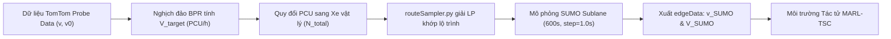

# CƠ SỞ KHOA HỌC THIẾT LẬP MÔ PHỎNG GIAO THÔNG TP. HỒ CHÍ MINH: TỪ VĨ MÔ ĐẾN VI MÔ
## (HCMC TRAFFIC SPECIFICATIONS & SIMULATION GROUNDING: FROM MACRO TO MICRO)

> **Tài liệu Kỹ thuật & Chuẩn hóa Hệ thống**  
> **Dự án:** Điều khiển Đèn Giao thông Thích ứng bằng Học tăng cường Đa tác tử (MARL-TSC)  
> **Khu vực áp dụng:** Trung tâm Quận 1 & Quận 3, TP. Hồ Chí Minh  
> **Nguyên tắc biên soạn:** Tuân thủ chuẩn mực Liêm chính Học thuật (Zero Hallucination đối với tài liệu và số liệu thực nghiệm; phân định minh bạch giữa số liệu đo đạc thực tế, quy chuẩn quốc gia và giả định kỹ thuật cần hiệu chuẩn).

---

## MỤC LỤC
1. [Chương 1: Thiết lập Giao thông Vĩ mô (Macroscopic Specifications)](#chương-1-thiết-lập-giao-thông-vĩ-mô-macroscopic-specifications)
   * 1.1. Hệ số quy đổi xe con tương đương (PCU) theo TCVN 13592:2022
   * 1.2. Cơ chế phân tầng tỷ lệ phương tiện (Modal Split) kèm biên độ sai số thực địa
   * 1.3. Năng lực thông hành làn đường tính toán (Capacity $C$) & Cơ chế ánh xạ từ TomTom FRC
2. [Chương 2: Thiết lập Động lực học Vi mô Xe máy trong SUMO (Microscopic Grounding)](#chương-2-thiết-lập-động-lực-học-vi-mô-xe-máy-trong-sumo-microscopic-grounding)
   * 2.1. Nền tảng Sublane Model cho dòng xe phi làn & Đánh giá độ phân giải ngang
   * 2.2. Bảng thông số hành vi xe máy trong `vtypes.add.xml` & Phân loại học thuật
   * 2.3. Hiệu chuẩn vận tốc tự do đô thị (`maxSpeed = 9.72 m/s` ~ 35 km/h) & Căn cứ pháp lý
3. [Chương 3: Phương pháp luận Khung toán học Hàm trở kháng BPR (BPR Formulation)](#chương-3-phương-pháp-luận-khung-toán-học-hàm-trở-kháng-bpr-bpr-formulation)
   * 3.1. Công thức BPR thuận & Công thức nghịch đảo giải lưu lượng mục tiêu ($V_{\text{target}}$)
   * 3.2. Cơ sở vật lý của các tham số trễ và quá tải đối với dòng xe máy hỗn hợp
   * 3.3. Đường ống chuyển đổi Simulation-in-the-loop (TomTom $\to$ routeSampler $\to$ SUMO Sublane)
4. [Chương 4: Danh mục Trích dẫn Chuẩn Quốc tế & Định dạng BibTeX](#chương-4-danh-mục-trích-dẫn-chuẩn-quốc-tế--định-dạng-bibtex)
   * 4.1. Danh mục tài liệu tham khảo chính thống
   * 4.2. Khối BibTeX chuẩn sẵn sàng đưa vào LaTeX / Overleaf

---

# CHƯƠNG 1: THIẾT LẬP GIAO THÔNG VĨ MÔ (MACROSCOPIC SPECIFICATIONS)

## 1.1. Hệ số quy đổi xe con tương đương (Passenger Car Unit - PCU)

Dòng giao thông đô thị Việt Nam mang tính không đồng nhất cao (heterogeneous traffic), trong đó xe máy chiếm ưu thế vượt trội nhưng có diện tích chiếm dụng mặt đường nhỏ và khả năng điền đầy các khoảng hở. Việc áp dụng chuẩn quốc tế của phương Tây (coi 1 xe máy = 0.5 hoặc 1.0 PCU) sẽ thổi phồng thể tích giao thông một cách phi lý.

Hệ số quy đổi PCU được xác lập **đồng bộ và duy nhất theo Tiêu chuẩn Quốc gia TCVN 13592:2022 (Đường đô thị - Yêu cầu thiết kế, Bảng 3)** [1] cho dải vận tốc thiết kế nội đô từ $30 - 50\text{ km/h}$:

| Lớp phương tiện | Mã lớp SUMO (`vClass`) | Hệ số quy đổi PCU | Căn cứ Quy chuẩn Quốc gia (TCVN 13592:2022) |
| :--- | :---: | :---: | :--- |
| **Xe mô tô, xe gắn máy 2 bánh** | `motorcycle` | **$0.30$** | **TCVN 13592:2022 (Bảng 3)** quy định hệ số $0.30$ cho dải vận tốc thiết kế $30, 40, 50\text{ km/h}$. |
| **Xe ô tô con (< 9 chỗ)** | `passenger` | **$1.00$** | **TCVN 13592:2022 (Bảng 3)**: Đơn vị xe con quy đổi chuẩn (Base Car Equivalent). |
| **Xe tải 2 trục & Xe buýt nhỏ/trung bình** | `delivery` / `bus` | **$2.50$** | **TCVN 13592:2022 (Bảng 3)** quy định cho dải vận tốc $30 - 50\text{ km/h}$. |
| **Xe buýt lớn ($\ge 25$ chỗ) & Xe tải $\ge 3$ trục** | `bus` | **$3.00$** | **TCVN 13592:2022 (Bảng 3)** quy định cho dải vận tốc $30 - 50\text{ km/h}$. |

*(Lưu ý: Toàn bộ hệ số PCU được tra cứu đồng nhất từ TCVN 13592:2022, loại bỏ việc trích dẫn chắp vá tiêu chuẩn ngoài đô thị TCVN 4054:2005).*

### Công thức tính Lưu lượng Xe vật lý thực tế:
Từ tổng thể tích $V_{\text{pcu}}$ (tính bằng PCU/h qua hàm BPR), số lượng xe vật lý thực tế $N_{\text{total}}$ nạp vào mô phỏng SUMO được tính qua trọng số trung bình $\overline{E}_{\text{road}}$ phân tầng theo từng loại đường:

$$\overline{E}_{\text{road}} = \sum_{k \in \{\text{moto}, \text{car}, \text{bus}\}} p_k \cdot \text{PCU}_k \implies N_{\text{total}} = \frac{V_{\text{pcu}}}{\overline{E}_{\text{road}}}$$

* **Trục chính đô thị (Primary - $85\%$ MC, $12\%$ Car, $3\%$ Bus):**
  $$\overline{E}_{\text{primary}} = 0.85 \times 0.3 + 0.12 \times 1.0 + 0.03 \times 2.5 = 0.450\text{ PCU/xe} \implies N_{\text{total}} \approx \mathbf{2.22} \times V_{\text{pcu}}$$
* **Đường nhánh / gom (Secondary - $92\%$ MC, $8\%$ Car, $0\%$ Bus):**
  $$\overline{E}_{\text{secondary}} = 0.92 \times 0.3 + 0.08 \times 1.0 = 0.356\text{ PCU/xe} \implies N_{\text{total}} \approx \mathbf{2.81} \times V_{\text{pcu}}$$
* **Đường nội bộ dân cư (Residential - $96\%$ MC, $4\%$ Car, $0\%$ Bus):**
  $$\overline{E}_{\text{residential}} = 0.96 \times 0.3 + 0.04 \times 1.0 = 0.328\text{ PCU/xe} \implies N_{\text{total}} \approx \mathbf{3.05} \times V_{\text{pcu}}$$

---

## 1.2. Cơ chế phân tầng tỷ lệ phương tiện (Modal Split) theo cấp đường

Để phản ánh chân thực dòng xe tại TP.HCM, mô hình đối chiếu với các bằng chứng thực nghiệm khảo sát thực địa của **Dung et al. (2015)** [3] và thiết lập kịch bản mô phỏng nội đô Quận 1 kèm biên độ sai số thực địa $\pm 3\% \sim 5\%$:

### Bằng chứng thực nghiệm khảo sát tại TP.HCM (Dung et al., 2015):
* Cơ cấu phương tiện toàn đô thị: Xe máy chiếm **$89\%$**, Ô tô con chiếm **$6\%$**, Phương tiện khác (xe buýt, xe tải) chiếm **$5\%$**.
* Tỷ lệ phân tầng theo cấp đường đo đạc thực tế:
  * **Cao tốc / Trục chính lớn (Điện Biên Phủ, Xa lộ Hà Nội):** Lưu lượng ô tô $940.62\text{ xe/h}$, xe máy $9,800.92\text{ xe/h} \to$ Tỷ lệ xe máy gấp $\approx 10$ lần ô tô ($91.2\%$ vs $8.8\%$).
  * **Đường trục đô thị (Xô Viết Nghệ Tĩnh):** Lưu lượng ô tô $171.08\text{ xe/h}$, xe máy $6,441.85\text{ xe/h} \to$ Tỷ lệ xe máy gấp gần $40$ lần ô tô ($97.5\%$ vs $2.5\%$).
  * **Đường nội bộ (D2):** Lưu lượng ô tô $95.38\text{ xe/h}$, xe máy $3,872.31\text{ xe/h} \to$ Tỷ lệ xe máy gấp gần $40$ lần ô tô ($97.6\%$ vs $2.4\%$).

### Thiết lập Kịch bản Mô phỏng Nội đô Quận 1:
> `[THIẾT LẬP KỊCH BẢN NỘI ĐÔ QUẬN 1 / CÓ BIÊN ĐỘ BIẾN THIÊN THỰC ĐỊA ±3–5%]`  
> Khu vực trung tâm Quận 1 quanh Dinh Độc Lập và Vòng xoay Hồ Con Rùa tập trung mật độ taxi, GrabCar và xe buýt cao hơn mức trung bình toàn thành phố. Nhằm phản ánh sự dao động lưu lượng giữa các khung giờ và ngày khảo sát, tỷ lệ phương tiện được thiết lập kèm biên độ sai số thực nghiệm $\pm 3\% \sim 5\%$:

| Cấp đường OSM (`highway`) | Tuyến đường đại diện tại Quận 1 | Xe máy ($p_{\text{moto}}$) | Xe con ($p_{\text{car}}$) | Xe buýt ($p_{\text{bus}}$) | Căn cứ Thực nghiệm & Kịch bản Mô phỏng |
| :--- | :--- | :---: | :---: | :---: | :--- |
| **Primary (Trục chính đô thị)** | Điện Biên Phủ, Nam Kỳ Khởi Nghĩa, Lê Duẩn | **$85\% \pm 3\%$** | **$12\% \pm 3\%$** | **$3\% \pm 2\%$** | Trục kết nối liên quận, mật độ ô tô/taxi cao, có tuyến xe buýt hoạt động. |
| **Secondary (Trục liên khu vực)** | Pasteur, Võ Văn Tần, Nguyễn Thị Minh Khai | **$92\% \pm 3\%$** | **$8\% \pm 3\%$** | **$0\%$** | Đường một chiều nội đô, không bố trí luồng tuyến buýt; xe máy chiếm ưu thế tuyệt đối. |
| **Tertiary / Residential (Đường gom, nội bộ)** | Tú Xương, Ngô Thời Nhiệm, Hồ Xuân Hương | **$96\% \pm 2\%$** | **$4\% \pm 2\%$** | **$0\%$** | Mặt cắt ngang hẹp ($7 - 10\text{m}$), cấm đỗ ô tô; chủ yếu là dòng xe máy tiếp cận. |

---

## 1.3. Năng lực thông hành làn đường tính toán (Capacity $C$) & Cơ chế Ánh xạ TomTom FRC

### Bản chất Phân loại FRC và Tiêu chuẩn Thiết kế:
* **FRC (Functional Road Class):** Là hệ thống phân cấp chức năng mạng lưới đường từ FRC0 đến FRC6 của cơ sở dữ liệu bản đồ số TomTom/OpenStreetMap, **không phải là thuật ngữ trong tiêu chuẩn xây dựng Việt Nam**.
* **Tiêu chuẩn Quốc gia TCVN 13592:2022 (Bảng 4 & Điều 8.2)** [1]: Quy định năng lực thông hành tính toán của một làn xe chạy ($P_{tt}$, đơn vị xcqđ/h/làn) cho từng cấp đường đô thị:
  * Đường cao tốc đô thị: $1.800\text{ PCU/làn/h}$.
  * Đường phố chính đô thị chủ yếu: $1.400 - 1.600\text{ PCU/làn/h}$.
  * Đường phố chính đô thị thứ yếu / trục liên khu vực: $1.100 - 1.300\text{ PCU/làn/h}$.
  * Đường phố gom: $900 - 1.100\text{ PCU/làn/h}$.
  * Đường nội bộ dân cư: $500 - 700\text{ PCU/làn/h}$.

### Cơ chế Ánh xạ Kỹ thuật (Mapping Logic):
> `[QUY CHUẨN ÁNH XẠ KỸ THUẬT NỘI BỘ GIỮA TOMTOM FRC VÀ TCVN 13592:2022]`  
> Tổng dung lượng đoạn đường $C_{\text{total}}$ được tính toán thông qua việc ánh xạ trực tiếp mã FRC trích xuất từ TomTom API sang giá trị năng lực tính toán $P_{tt}$ theo TCVN 13592:2022 nhân với số lượng làn xe vật lý $n_{\text{lanes}}$:
> $$C_{\text{total}} = P_{tt}(\text{FRC}) \times n_{\text{lanes}}$$

| Cấp chức năng TomTom (FRC) | Cấp đường đô thị tương đương theo TCVN 13592:2022 | Năng lực thông hành tính toán $P_{tt}$ (PCU/làn/h) | Tuyến đường đại diện tại Quận 1 |
| :--- | :--- | :---: | :--- |
| **FRC0** | Cao tốc đô thị (dòng xe liên tục, cách ly hoàn toàn) | **$1.800$** | *(Không có trong phạm vi lõi Quận 1)* |
| **FRC1 / FRC2** | Đường phố chính đô thị chủ yếu | **$1.500$** | Điện Biên Phủ, Nam Kỳ Khởi Nghĩa, Lê Duẩn |
| **FRC3** | Đường phố chính đô thị thứ yếu / Trục liên khu vực | **$1.200$** | Pasteur, Võ Thị Sáu, CMT8, NTMK |
| **FRC4** | Đường phố gom đô thị | **$1.000$** | Alexandre de Rhodes, Công xã Paris |
| **FRC5 / FRC6** | Đường nội bộ khu dân cư, đường nhánh hẹp | **$600$** | Tú Xương, Ngô Thời Nhiệm, đường tiếp cận |

---

# CHƯƠNG 2: THIẾT LẬP ĐỘNG LỰC HỌC VI MÔ XE MÁY TRONG SUMO (MICROSCOPIC GROUNDING)

## 2.1. Nền tảng Sublane Model cho dòng xe phi làn (Non-lane-based Traffic)

Mô hình mô phỏng truyền thống của phương Tây giả định phương tiện bám theo tâm làn (`lane-based center`). Đối với TP.HCM, giả định này phá vỡ hoàn toàn động thái giao thông.
* **Mô hình Sublane của SUMO (Semrau & Erdmann, DLR 2016)** [4]: Chia mặt đường vật lý thành các làn ảo liên tục theo phương ngang với cờ cấu hình `--lateral-resolution`.
* **Cơ chế luồn lách (Filtering & Seeping):** Cho phép các phương tiện kích thước nhỏ (xe máy) tự do định vị ngang (`latAlignment="arbitrary"`), luồn lách qua các khe hở hẹp giữa các thân xe ô tô song song.

### Phân tích Phản biện về Độ phân giải ngang (`lateral-resolution`):
* Giá trị `lateral-resolution = 0.8m` của SUMO ban đầu được các nhà phát triển khuyến nghị nhằm xử lý lỗi xe ô tô đi lệch tâm làn.
* Đối với dòng xe máy hỗn hợp phương Đông, các nghiên cứu chuyên sâu (như *Codecà & Härri 2019* [7] trong kịch bản Monaco MoST, hoặc các nghiên cứu về thẩm thấu xe máy) thường sử dụng độ phân giải mịn hơn: **$0.2\text{m} - 0.3\text{m}$**.
* **Hạn chế kỹ thuật cần lưu ý:** Trong cơ chế của SUMO, chiều rộng xe máy ($0.8\text{m}$) khi đặt `lateral-resolution = 0.8m` sẽ được làm tròn thành đúng 1 sublane nguyên. Điều này có thể khiến khoảng cách an toàn ngang `minGapLat = 0.2m` bị hạn chế một phần tác dụng trong quá trình tìm khe hở vượt xe. Trong các nghiên cứu tiếp theo, đề tài khuyến nghị chạy đối chuẩn so sánh giữa độ phân giải $0.8\text{m}$ và $0.3\text{m}$.

---

## 2.2. Bảng thông số hành vi xe máy trong `vtypes.add.xml` & Phân loại học thuật

Toàn bộ các tham số định nghĩa hành vi xe máy trong tệp `data/raw_data/vtypes.add.xml` được đối chiếu trực tiếp từ nghiên cứu thực nghiệm đo đạc camera/UAV tại TP.HCM (Trinh et al., 2021 [5]; Dung et al., 2015 [3]) và Tiêu chuẩn Quốc gia, có gắn nhãn phân loại học thuật minh bạch:

| Tham số SUMO | Giá trị | Đơn vị | Cơ sở khoa học & Ý nghĩa vật lý | Phân loại học thuật |
| :--- | :---: | :---: | :--- | :---: |
| **`length` / `width`** | `1.8` / `0.8` | mét ($m$) | Kích thước bao hình học trung bình các dòng xe Wave, Vision, AirBlade tại TP.HCM (TCVN 13592:2022). | `[QUY CHUẨN THỰC ĐỊA]` |
| **`minGap`** | `0.5` | mét ($m$) | Khoảng cách an toàn dọc tối thiểu khi dừng chờ đèn đỏ. Phù hợp với đặc tính dừng áp sát của xe 2 bánh (Kuo et al., 2023 [8]). | `[GIẢ ĐỊNH / CHƯA CHẠY THỰC NGHIỆM]` |
| **`minGapLat`** | `0.2` | mét ($m$) | Khoảng cách an toàn ngang tối thiểu khi luồn lách qua khe hẹp. Tương thích với `lateral-resolution="0.8"` của SUMO. | `[GIẢ ĐỊNH / CHƯA CHẠY THỰC NGHIỆM]` |
| **`latAlignment`** | `"arbitrary"` | chuỗi | Cho phép xe máy định vị ngang tự do trên mặt cắt làn, không bám tâm làn (Trinh et al., 2021 [5]; Semrau & Erdmann, 2016 [4]). | `[ĐẶC TẢ SUMO SUBLANE]` |
| **`lcSublane`** | `1.0` | hệ số | Mức độ tận dụng các làn phụ ảo. $1.0$ là **giá trị mặc định** trong khoảng $[0, \infty)$ (Semrau & Erdmann, 2016), không phải giá trị tối đa. | `[ĐẶC TẢ SUMO MẶC ĐỊNH]` |
| **`lcPushy`** | `0.5` | $[0, 1]$ | Mức độ chen lấn chủ động khi nhập dòng/vượt xe (Codecà & Härri 2019 [7] khuyến cáo dùng $0.25 - 0.5$ để tránh nghẽn nhân tạo deadlock). | `[GIẢ ĐỊNH / CẦN HIỆU CHUẨN]` |
| **`accel`** | `1.5` | $\text{m/s}^2$ | Gia tốc thoải mái của xe máy. Đo đạc UAV thực nghiệm tại Ngã 6 Nguyễn Tri Phương (Trinh et al., 2021 [5]) chỉ ra $74.8\%$ xe máy có gia tốc trong dải $-0.4 \sim +0.4\text{ m/s}^2$, và chỉ $4.2\%$ vượt quá $1.0\text{ m/s}^2$. Mức $1.5\text{ m/s}^2$ đảm bảo xe xuất phát linh hoạt mà không bị vọt tốc phi lý. | `[SỐ LIỆU ĐO ĐẠC THỰC ĐỊA HCMC]` |
| **`decel`** | `2.5` | $\text{m/s}^2$ | Gia tốc giảm tốc bình thường trong luồng xe đông (hạ từ mức $4.5\text{ m/s}^2$ cũ để tránh hiện tượng phanh giật nhân tạo). | `[GIẢ ĐỊNH KỸ THUẬT]` |
| **`emergencyDecel`** | `5.0` | $\text{m/s}^2$ | Gia tốc phanh khẩn cấp phòng tránh va chạm (vật lý ma sát bám lốp trên mặt đường khô). | `[QUY CHUẨN VẬT LÝ]` |
| **`sigma`** | `0.5` | $[0, 1]$ | Mức độ dao động tay ga không hoàn hảo của người lái (Mô hình Car-following Krauß 1998 [9]). | `[MÔ HÌNH CAR-FOLLOWING]` |
| **`maxSpeed`** | `9.72` | $\text{m/s}$ | $35.0\text{ km/h}$, neo theo vận tốc tự do TomTom tại Quận 1 ($v_0 = 30.09\text{ km/h}$) để triệt tiêu sai số trần tốc độ. | `[HIỆU CHUẨN THỰC ĐỊA]` |

---

## 2.3. Hiệu chuẩn Vận tốc Tự do Đô thị (`maxSpeed = 9.72 m/s` ~ 35 km/h) & Căn cứ Pháp lý

### Căn cứ Pháp lý Tốc độ (Thông tư 31/2019/TT-BGTVT):
* Theo quy định tại **Thông tư 31/2019/TT-BGTVT (Điều 6 & Điều 7)** [2] về tốc độ tối đa cho phép trong khu vực đông dân cư:
  * Đường đôi; đường một chiều có từ 2 làn xe cơ giới trở lên: Tối đa **$60\text{ km/h}$** ($16.67\text{ m/s}$).
  * Đường hai chiều; đường một chiều có 1 làn xe cơ giới: Tối đa **$50\text{ km/h}$** ($13.89\text{ m/s}$).
  * Xe gắn máy (dung tích xi-lanh $< 50\text{ cm}^3$): Tối đa **$40\text{ km/h}$**.
* Trên thực tế, nhiều trục đường chính một chiều tại Quận 1 (Điện Biên Phủ, Pasteur, Nam Kỳ Khởi Nghĩa) có từ 2 đến 3 làn xe, thuộc nhóm tốc độ pháp lý tối đa $60\text{ km/h}$.

### Căn cứ Đo đạc Thực tế TomTom Probe Data & Lựa chọn Thiết kế:
* Mặc dù trần pháp lý là $50 - 60\text{ km/h}$, dữ liệu hành trình vệ tinh TomTom đo đạc liên tục trên 66 tuyến đường Quận 1 cho thấy:
  * Vận tốc dòng tự do ban ngày ($v_0$) chỉ đạt trung bình **$30.09\text{ km/h}$** ($\approx 8.36\text{ m/s}$).
  * Vận tốc thực tế hiếm khi vượt quá **$35\text{ km/h}$** ($9.72\text{ m/s}$) do chiều dài đoạn phố rất ngắn ($150 - 300\text{m}$), nhiều nút giao đèn tín hiệu liên tiếp và ma sát bên lớn (người đi bộ, hàng quán, xe ra vào hẻm).
* **Đính chính động học và lựa chọn thiết kế:**
  * Nếu giữ nguyên trần $50 - 60\text{ km/h}$ trong SUMO: Mỗi khi gặp khoảng hở sau ngã tư, xe máy với gia tốc xuất phát $1.5\text{ m/s}^2$ sau khoảng $6.5\text{ giây}$ sẽ đạt $35\text{ km/h}$ và tiếp tục vọt lên $45 - 50\text{ km/h}$, tạo ra sai số dương nhân tạo từ $+10 \sim 15\text{ km/h}$ so với thực tế TomTom.
  * **Quyết định thiết kế (Design Choice):** Gán `maxSpeed="9.72"` ($35.0\text{ km/h}$) cho xe máy trong `vtypes.add.xml` là giải pháp kỹ thuật đã được cân chỉnh thực địa nhằm neo mốc tự do $v_0$ của SUMO sát với TomTom, đảm bảo tính ổn định cho hàm trở kháng BPR.

---

# CHƯƠNG 3: PHƯƠNG PHÁP LUẬN KHUNG TOÁN HỌC HÀM TRỞ KHÁNG BPR (BPR FORMULATION)

## 3.1. Công thức BPR thuận & Công thức nghịch đảo giải lưu lượng mục tiêu ($V_{\text{target}}$)

Hàm liên hệ giữa Thời gian hành trình ($t$) và Lưu lượng giao thông ($V$) theo chuẩn Cục Đường bộ Mỹ (Bureau of Public Roads - BPR 1964) [10]:

$$t = t_0 \left[ 1 + \alpha \left( \frac{V}{C} \right)^\beta \right] \quad \Longleftrightarrow \quad v = \frac{v_0}{1 + \alpha \left( \frac{V}{C} \right)^\beta}$$

Để chuyển đổi ngược từ dữ liệu vận tốc vệ tinh TomTom Probe Data ($t = L/v, t_0 = L/v_0$) sang lưu lượng xe mục tiêu $V_{\text{target}}$ (đơn vị PCU/h):

$$V_{\text{target}} = C \cdot \left[ \frac{1}{\alpha} \left( \frac{t - t_0}{t_0} \right) \right]^{1/\beta} = C \cdot \left[ \frac{1}{\alpha} \left( \frac{v_0}{v} - 1 \right) \right]^{1/\beta}$$

*Điều kiện biên kỹ thuật:* Nếu vận tốc đo đạc $v \ge v_0$, gán $V_{\text{target}} = 0.05 \cdot C$ (dòng xe thông thoáng cơ bản).

---

## 3.2. Cơ sở vật lý của các tham số trễ và quá tải đối với dòng xe máy hỗn hợp

* **Tham số mặc định Cục Đường bộ Mỹ (US BPR 1964) [10]:** $\alpha = 0.15$ và $\beta = 4.0$. Bộ tham số này được xây dựng cho đường cao tốc Bắc Mỹ với dòng ô tô thuần nhất tuân thủ làn cứng tuyệt đối.
* **Đặc thù dòng xe máy hỗn hợp TP.HCM:**
  * **Hệ số trễ cận biên $\alpha$ tăng cao:** Phản ánh hiện tượng **ma sát ngang xuất hiện sớm (Early Lateral Friction)**. Xe máy thường xuyên chuyển làn, tạt đầu ô tô khiến tốc độ sụt giảm nhanh ngay khi đường mới đông nhẹ ($V/C \approx 0.4 - 0.7$).
  * **Số mũ độ dốc $\beta$ giảm mạnh:** Phản ánh **khả năng thẩm thấu qua khe hở (Motorcycle Seepage / Porosity)**. Khi quá tải ($V/C \ge 1.0$), ô tô bị khóa cứng, nhưng xe máy vẫn luồn lách duy trì tốc độ bò $8 - 12\text{ km/h}$. Dòng xe không bị sập chết dốc đứng như ô tô phương Tây.
* **Trạng thái thực nghiệm:**
  > `[ĐANG TRONG QUÁ TRÌNH HIỆU CHUẨN / CHƯA CHỐT THỰC NGHIỆM]`  
  > Các khoảng giá trị khảo sát sơ bộ $(\alpha = 0.50 - 0.65, \beta = 1.80 - 2.50)$ là kết quả thực nghiệm sơ bộ trên dữ liệu TomTom Quận 1 của đề tài, không phải trích dẫn từ bài báo quốc tế nào khác. Bộ tham số này cần tiếp tục được kiểm chuẩn đa seeds và nghiệm thu thực nghiệm.

---

## 3.3. Đường ống chuyển đổi Simulation-in-the-loop

Toàn bộ quy trình nạp nhu cầu vĩ mô vào mô phỏng vi mô SUMO được tự động hóa khép kín:



1. **Bước 1 (Ánh xạ vĩ mô):** `generate_sumo_counts.py` đọc dữ liệu TomTom, tính $V_{\text{target}}$ qua hàm BPR và xuất ra `edge_counts.xml`.
2. **Bước 2 (Hiệu chỉnh lộ trình):** Công cụ `routeSampler.py` giải bài toán quy hoạch tuyến tính (Linear Programming) để lựa chọn và co giãn số lượng xe từ tập lộ trình ứng viên (`candidate_routes.rou.xml`), xuất ra file `calibrated_routes.rou.xml`.
3. **Bước 3 (Thực thi vi mô):** SUMO kích hoạt chế độ Sublane Model (`lateral-resolution="0.8"`), `step-length="1.0"`, `time-to-teleport="120"`.
4. **Bước 4 (Cung cấp môi trường):** Dòng xe sau khi mô phỏng phản ánh đúng lưu lượng và vận tốc thực tế, đóng vai trò là môi trường Dec-POMDP chân thực cho các thuật toán điều khiển đèn tín hiệu (MARL-TSC).

---

# CHƯƠNG 4: DANH MỤC TRÍCH DẪN CHUẨN QUỐC TẾ & ĐỊNH DẠNG BIBTEX

## 4.1. Danh mục tài liệu tham khảo chính thống

1. **Bộ Giao thông Vận tải (2022).** *Tiêu chuẩn Quốc gia TCVN 13592:2022 - Đường đô thị: Yêu cầu thiết kế*. NXB Xây dựng, Hà Nội.
2. **Bộ Giao thông Vận tải (2019).** *Thông tư số 31/2019/TT-BGTVT: Quy định về tốc độ và khoảng cách an toàn của xe cơ giới, xe máy chuyên dùng tham gia giao thông đường bộ*. Hà Nội.
3. **Dung, C. T., Miwa, T., Sato, H., & Morikawa, T. (2015).** "Analysis on Characteristics of Passenger Car and Motorcycle Fleets and Their Driving Conditions in Developing Country: A Case Study in Ho Chi Minh City, Vietnam." *Journal of the Eastern Asia Society for Transportation Studies*, 11, pp. 1096–1111.
4. **Semrau, M., & Erdmann, J. (2016).** "Simulation of sublane-based dynamics with SUMO." *SUMO2016 - Traffic, Mobility, and Logistics*, pp. 105–118. German Aerospace Center (DLR).
5. **Trinh, L. T., Sano, K., Hatoyama, K., & De Silva, C. K. (2021).** "Analysis of motorcycle microscopic characteristics at roundabouts under mixed traffic condition: A case study of Vietnam." *Journal of Traffic and Transportation Engineering (English Edition)*, 8(4), pp. 605–619.
6. **Minh, C. C., Sano, K., & Matsumoto, S. (2005).** "Characteristics of Passing and Paired Riding Maneuvers of Motorcycle." *Journal of the Eastern Asia Society for Transportation Studies*, 6, pp. 186–197.
7. **Codecà, L., & Härri, J. (2019).** "Towards Multimodal Mobility Simulation of Monaco: a Sublane Model for Motorcycles." *2019 IEEE Vehicular Networking Conference (VNC)*, pp. 1–4.
8. **Kuo, P. F., Chen, J. D., & Wong, K. I. (2023).** "A Comparison of Microscopic Traffic Simulation Systems for Powered-Two-Wheeler Traffic." *Proceedings of the Eastern Asia Society for Transportation Studies*, 14.
9. **Krauß, S. (1998).** *Microscopic modeling of traffic flow: Investigation of collision free vehicle dynamics*. Ph.D. thesis, University of Cologne, Germany.
10. **Bureau of Public Roads (BPR). (1964).** *Traffic Assignment Manual*. U.S. Department of Commerce, Urban Planning Division, Washington, D.C.
11. **JICA & UBND TP.HCM (2004).** *The Study on Urban Transport Master Plan in the Ho Chi Minh City Metropolitan Area (HOUTRANS)*. Final Report, Japan International Cooperation Agency.
12. **Lan, L. W., Chiou, Y. C., Lin, Z. S., & Hsu, C. C. (2010).** "Cellular automaton simulations for mixed traffic with erratic motorcycles' behaviours." *Physica A: Statistical Mechanics and its Applications*, 389(10), pp. 2077–2089.

---

## 4.2. Khối BibTeX chuẩn sẵn sàng đưa vào LaTeX / Overleaf

```bibtex
@standard{tcvn13592_2022,
  title        = {TCVN 13592:2022 - Duong do thi: Yeu cau thiet ke (Urban roads - Specifications for design)},
  organization = {Bo Giao thong Van tai (Ministry of Transport of Vietnam)},
  year         = {2022},
  address      = {Ha Noi, Viet Nam}
}

@article{dung2015analysis,
  author    = {Dung, Chu Tien and Miwa, Tomio and Sato, Hitomi and Morikawa, Takayuki},
  title     = {Analysis on Characteristics of Passenger Car and Motorcycle Fleets and Their Driving Conditions in Developing Country: A Case Study in Ho Chi Minh City, Vietnam},
  journal   = {Journal of the Eastern Asia Society for Transportation Studies},
  volume    = {11},
  pages     = {1096--1111},
  year      = {2015}
}

@article{trinh2021analysis,
  author    = {Trinh, Linh Thanh and Sano, Kazushi and Hatoyama, Kiichiro and De Silva, Chathura Kovida},
  title     = {Analysis of motorcycle microscopic characteristics at roundabouts under mixed traffic condition: A case study of Vietnam},
  journal   = {Journal of Traffic and Transportation Engineering (English Edition)},
  volume    = {8},
  number    = {4},
  pages     = {605--619},
  year      = {2021},
  publisher = {Elsevier},
  doi       = {10.1016/j.jtte.2020.08.002}
}

@inproceedings{semrau2016simulation,
  author    = {Semrau, Michael and Erdmann, Jakob},
  title     = {Simulation of sublane-based dynamics with SUMO},
  booktitle = {SUMO2016 - Traffic, Mobility, and Logistics},
  pages     = {105--118},
  year      = {2016},
  publisher = {German Aerospace Center (DLR)}
}

@article{minh2005passing,
  author    = {Minh, Chu Cong and Sano, Kazushi and Matsumoto, Shoji},
  title     = {Characteristics of Passing and Paired Riding Maneuvers of Motorcycle},
  journal   = {Journal of the Eastern Asia Society for Transportation Studies},
  volume    = {6},
  pages     = {186--197},
  year      = {2005}
}

@inproceedings{codeca2019towards,
  author    = {Codec{\`a}, Lara and H{\"a}rri, J{\'e}r{\^o}me},
  title     = {Towards Multimodal Mobility Simulation of Monaco: a Sublane Model for Motorcycles},
  booktitle = {2019 IEEE Vehicular Networking Conference (VNC)},
  pages     = {1--4},
  year      = {2019},
  organization = {IEEE}
}

@inproceedings{kuo2023comparison,
  author    = {Kuo, P. F. and Chen, J. D. and Wong, K. I.},
  title     = {A Comparison of Microscopic Traffic Simulation Systems for Powered-Two-Wheeler Traffic},
  booktitle = {Proceedings of the Eastern Asia Society for Transportation Studies},
  volume    = {14},
  year      = {2023}
}

@phdthesis{krauss1998microscopic,
  author    = {Krauss, Stefan},
  title     = {Microscopic modeling of traffic flow: Investigation of collision free vehicle dynamics},
  school    = {University of Cologne},
  year      = {1998},
  address   = {Cologne, Germany}
}

@techreport{bpr1964,
  author      = {{Bureau of Public Roads}},
  title       = {Traffic Assignment Manual},
  institution = {U.S. Department of Commerce, Urban Planning Division},
  year        = {1964},
  address     = {Washington, D.C.}
}

@techreport{houtrans2004,
  author      = {{Japan International Cooperation Agency (JICA)} and {HCMC People's Committee}},
  title       = {The Study on Urban Transport Master Plan in the Ho Chi Minh City Metropolitan Area (HOUTRANS)},
  institution = {JICA},
  year        = {2004},
  address     = {Ho Chi Minh City, Vietnam}
}

@article{lan2010cellular,
  author    = {Lan, Lawrence W. and Chiou, Yu-Chiun and Lin, Zhi-Sheng and Hsu, Chun-Chieh},
  title     = {Cellular automaton simulations for mixed traffic with erratic motorcycles' behaviours},
  journal   = {Physica A: Statistical Mechanics and its Applications},
  volume    = {389},
  number    = {10},
  pages     = {2077--2089},
  year      = {2010}
}
```
