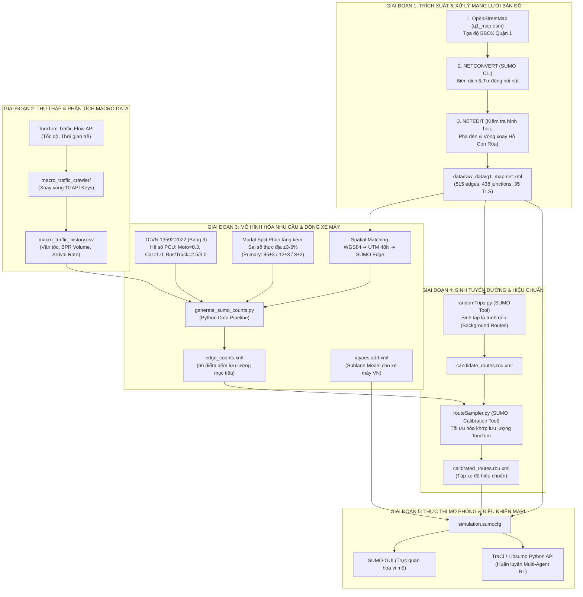

# XÂY DỰNG BỘ DỮ LIỆU & PIPELINE MÔ PHỎNG GIAO THÔNG QUẬN 1 (TP. HỒ CHÍ MINH)

> **Mục tiêu:** 
> 1. Xây dựng kịch bản giao thông vi mô thực tế tại khu vực trung tâm TP.HCM (Quận 1 - Quận 3 quanh Dinh Độc Lập và Vòng xoay Hồ Con Rùa).
> 2. Chuyển đổi dữ liệu lưu lượng vĩ mô (TomTom Probe Data) thành luồng xe vi mô trong SUMO.
> 3. Mô phỏng đặc thù dòng xe máy hỗn hợp không tuân thủ làn cứng (Sublane Model).
> 4. Hiệu chuẩn (Calibration) để lưu lượng trong mô phỏng khớp với thực tế ngoài đời.

---

## SƠ ĐỒ PIPELINE TỔNG THỂ



---

## CHI TIẾT TỪNG BƯỚC THỰC HIỆN TRONG PIPELINE

### BƯỚC 1: TRÍCH XUẤT VÀ DỰNG BẢN ĐỒ MẠNG LƯỚI SUMO

* **Công cụ sử dụng:** OpenStreetMap (OSM), `netconvert` (SUMO Command Line), `netedit` (SUMO GUI).
* **Đầu vào:** Tọa độ địa lý Bounding Box khu vực nghiên cứu:
  * `Upper (Bắc):` 10.782068
  * `Bottom (Nam):` 10.775291
  * `Left (Tây):` 106.686022
  * `Right (Đông):` 106.698661
* **Cách thực hiện:**
  1. Trích xuất file dữ liệu thô OSM: `macro_traffic_crawler/data/raw/q1_map.osm`.
  2. Sử dụng lệnh `netconvert` với cờ cấu hình tối ưu hóa cho mạng lưới đô thị Việt Nam:
     ```bash
     netconvert --osm-files macro_traffic_crawler/data/raw/q1_map.osm \
                -o data/raw_data/q1_map.net.xml \
                --geometry.remove \
                --roundabouts.guess \
                --ramps.guess \
                --junctions.join \
                --tls.guess-signals \
                --tls.discard-simple \
                --tls.join
     ```
  3. **Ý nghĩa các tham số:**
     * `--roundabouts.guess`: Nhận diện hình học vòng xoay Hồ Con Rùa thành `<roundabout>` trong SUMO để áp dụng luật nhường đường chuẩn.
     * `--junctions.join`: Gom các cụm nút giao nhỏ phức tạp sát nhau thành một giao lộ duy nhất.
     * `--tls.guess-signals` & `--tls.join`: Tự động nhận diện và ghép các đèn tín hiệu giao thông (TLS) liên kết.
     * `--geometry.remove`: Tránh đường bị chia vụn thành hàng trăm đoạn nhỏ.
     * `--ramps.guess`: Tránh xe dừng khựng vô lý tại các góc rẽ phải, vòng xoay.
     * `--tls.discard-simple`: Loại bỏ đèn tín hiệu ở nút giao thông (có 1 hướng vào/ra hoặc các đoạn thẳng không có luồng xe cắt qua).

* **Đầu ra:** File mạng lưới hoàn chỉnh `data/raw_data/q1_map.net.xml` (gồm 515 cạnh, 438 nút giao, 35 cụm đèn tín hiệu và 2 vòng xoay).

---

### BƯỚC 2: THU THẬP DỮ LIỆU MACRO TỪ TOMTOM TRAFFIC API

* **Công cụ sử dụng:** Python (`requests`, `pandas`), TomTom Traffic Flow API.
* **Mã nguồn:** `macro_traffic_crawler/extract_osm_points.py`, `scheduled_crawler.py`.
* **Cách thực hiện:**
  1. Dùng `extract_osm_points.py` trích xuất 66 điểm đo trọng yếu (bao phủ đủ các trục chính Nam Kỳ Khởi Nghĩa, Pasteur, Lê Duẩn, Nguyễn Thị Minh Khai, và 4 cung phần tư của vòng xoay Hồ Con Rùa).
  2. Dùng `scheduled_crawler.py` xoay vòng API Keys để cào dữ liệu định kỳ.
  3. Tính toán Khả năng thông hành làn đường $C$ theo quy chuẩn **TCVN 13592:2022** [1] và ước tính lưu lượng xe theo hàm nghịch đảo **BPR (Bureau of Public Roads)** [2]:
     $$V = C \times \left[ \frac{1}{\alpha} \left( \frac{t - t_0}{t_0} \right) \right]^{1/\beta}$$
     * **Ghi chú chuẩn hóa:**
       * Bản gốc chuẩn Cục Đường bộ Mỹ (US BPR 1964): $\alpha = 0.15$ và $\beta = 4.0$.
       * Đối với dòng giao thông hỗn hợp xe máy tại TP.HCM: Bộ tham số $(\alpha, \beta)$ cần được hiệu chuẩn lại để phản ánh đúng thực tế lưu thông đô thị. Hiện tại quá trình chạy tối ưu hóa thực nghiệm đang tiếp tục được đo đạc, kiểm chuẩn đa seeds và chưa chốt giá trị chính thức; mục này được gắn nhãn `[ĐANG TRONG QUÁ TRÌNH HIỆU CHUẨN / CHƯA CHỐT THỰC NGHIỆM]`.
* **Đầu ra:** `macro_traffic_dense_1min.csv` chứa vận tốc thực tế, vận tốc tự do, độ trễ và lưu lượng quy đổi (PCU/h).

---

### BƯỚC 3: MÔ HÌNH HÓA NHU CẦU & ĐẶC TÍNH XE MÁY HỖN HỢP

* **Công cụ sử dụng:** Python (`generate_sumo_counts.py`), XML.
* **Cách thực hiện:**
  1. **Quy đổi PCU sang Phương tiện Vật lý (Physical Vehicles):**
     * Tra cứu đồng bộ theo **TCVN 13592:2022 (Bảng 3 - Hệ số quy đổi các loại xe ra xe con quy đổi)** [1] cho đường đô thị có vận tốc thiết kế $30 - 50\text{ km/h}$:
       * **Xe mô tô, xe gắn máy 2 bánh:** **$0.30\text{ PCU}$**
       * **Xe ô tô con (< 9 chỗ):** **$1.00\text{ PCU}$** (Đơn vị xe con quy đổi cơ sở)
       * **Xe tải 2 trục và xe buýt cỡ nhỏ, trung bình:** **$2.50\text{ PCU}$**
       * **Xe buýt cỡ lớn ($\ge 25$ chỗ) và xe tải từ 3 trục trở lên:** **$3.00\text{ PCU}$**
     *(Toàn bộ các loại phương tiện đều được tra cứu nhất quán theo TCVN 13592:2022 Bảng 3, loại bỏ hoàn toàn việc trích dẫn chắp vá tiêu chuẩn ngoài đô thị TCVN 4054:2005).*

  2. **Phân tầng Tỷ lệ Phương tiện (Modal Split) theo cấp đường kèm Sai số thực địa ($\pm 3 - 5\%$):**
     * **Bằng chứng thực nghiệm khảo sát tại TP.HCM (Dung et al., 2015 [3]):**
       * Cơ cấu chung toàn thành phố: Xe máy $89\%$, Ô tô con $6\%$, Phương tiện khác $5\%$.
       * Đường cao tốc / Trục chính (Điện Biên Phủ, Xa lộ Hà Nội): Tỷ lệ xe máy / ô tô $\approx 10:1$ (Xe máy chiếm $\sim 91.2\%$, Ô tô chiếm $\sim 8.8\%$).
       * Đường trục đô thị (Xô Viết Nghệ Tĩnh) & Đường nội bộ (D2): Tỷ lệ xe máy / ô tô $\approx 40:1$ (Xe máy chiếm $\sim 97.5\%$, Ô tô chiếm $\sim 2.5\%$).
     * **Thiết lập Kịch bản Mô phỏng Nội đô Quận 1 `[THIẾT LẬP KỊCH BẢN NỘI ĐÔ QUẬN 1 / CÓ BIÊN ĐỘ BIẾN THIÊN THỰC ĐỊA $\pm 3-5\%$]`:**
       Khu vực trung tâm Quận 1 quanh Dinh Độc Lập và Vòng xoay Hồ Con Rùa có mật độ xe taxi, GrabCar và xe buýt cao hơn mức trung bình toàn đô thị. Nhằm phản ánh sự dao động ngẫu nhiên giữa các khung giờ và các ngày khảo sát, tỷ lệ phương tiện được thiết lập kèm biên độ sai số thực nghiệm $\pm 3\% \sim 5\%$:
       * **Trục chính lớn (Primary - Lê Duẩn, NKKN, Điện Biên Phủ):** Xe máy $85\% \pm 3\%$, Ô tô con $12\% \pm 3\%$, Xe buýt $3\% \pm 2\%$.
       * **Đường nhánh / gom (Secondary - Pasteur, Võ Văn Tần, NTMK):** Xe máy $92\% \pm 3\%$, Ô tô con $8\% \pm 3\%$, Xe buýt $0\%$.
       * **Đường nội bộ dân cư (Residential / Tertiary):** Xe máy $96\% \pm 2\%$, Ô tô con $4\% \pm 2\%$, Xe buýt $0\%$.

  3. **Ánh xạ Không gian (Spatial Matching):**
     * Chuyển đổi tọa độ GPS $(lat, lon)$ sang hệ tọa độ phẳng UTM Zone 48N, cộng vector bù tọa độ `netOffset` của file `q1_map.net.xml`.
     * Tìm đoạn đường (edge) gần nhất trên bản đồ SUMO bằng thuật toán khoảng cách Euclidean điểm-đoạn thẳng.

  4. Chạy lệnh tạo file đếm xe mục tiêu:
     ```bash
     python macro_traffic_crawler/generate_sumo_counts.py
     ```

  5. **Cấu hình Hành vi Xe máy Việt Nam (Sublane Model) trong `vtypes.add.xml`:**
     Dòng xe máy tại Việt Nam di chuyển phi làn (non-lane-based), luồn lách qua các khoảng hở giữa các ô tô. Mô hình sử dụng Sublane Model của SUMO (Semrau & Erdmann, 2016 [4]) kết hợp số liệu vi mô thực nghiệm đo đạc bằng UAV tại TP.HCM (Trinh et al., 2021 [5]):

     | Tham số SUMO | Giá trị | Đơn vị | Cơ sở khoa học & Ý nghĩa vật lý | Phân loại học thuật |
     | :--- | :---: | :---: | :--- | :---: |
     | **`length` / `width`** | `1.8` / `0.8` | mét | Kích thước bao hình học phổ biến của xe Wave, Vision, AirBlade tại TP.HCM (TCVN 13592:2022). | `[QUY CHUẨN THỰC ĐỊA]` |
     | **`minGap`** | `0.5` | mét | Khoảng cách an toàn dọc tối thiểu khi dừng chờ đèn đỏ. Phù hợp với đặc tính dừng áp sát của xe 2 bánh (Kuo et al., 2023). | `[GIẢ ĐỊNH / CHƯA CHẠY THỰC NGHIỆM]` |
     | **`minGapLat`** | `0.2` | mét | Khoảng cách an toàn ngang tối thiểu khi luồn lách qua khe hẹp. Tương thích với `lateral-resolution="0.8"` của SUMO. | `[GIẢ ĐỊNH / CHƯA CHẠY THỰC NGHIỆM]` |
     | **`latAlignment`** | `"arbitrary"` | chuỗi | Cho phép xe máy định vị ngang tự do trên mặt cắt làn, không bám tâm làn (Trinh et al., 2021; Semrau & Erdmann, 2016). | `[ĐẶC TẢ SUMO SUBLANE]` |
     | **`accel`** | `1.5` | $\text{m/s}^2$ | Gia tốc thoải mái của xe máy. Đo đạc UAV thực nghiệm tại Ngã 6 Nguyễn Tri Phương (Trinh et al., 2021 [5]) chỉ ra $74.8\%$ xe máy có gia tốc trong dải $-0.4 \sim +0.4\text{ m/s}^2$, và chỉ $4.2\%$ vượt quá $1.0\text{ m/s}^2$. Mức $1.5\text{ m/s}^2$ đảm bảo xe xuất phát linh hoạt mà không bị vọt tốc phi lý. | `[SỐ LIỆU ĐO ĐẠC THỰC ĐỊA HCMC]` |
     | **`decel`** | `2.5` | $\text{m/s}^2$ | Gia tốc giảm tốc bình thường trong luồng xe đông (hạ từ mức $4.5\text{ m/s}^2$ cũ để tránh giật xe). | `[GIẢ ĐỊNH KỸ THUẬT]` |
     | **`emergencyDecel`** | `5.0` | $\text{m/s}^2$ | Phanh khẩn cấp phòng tránh va chạm (vật lý ma sát lốp trên mặt đường khô). | `[QUY CHUẨN VẬT LÝ]` |
     | **`sigma`** | `0.5` | $[0, 1]$ | Mức độ dao động tay ga không hoàn hảo của người lái (Mô hình Car-following Krauß 1998). | `[MÔ HÌNH CAR-FOLLOWING]` |
     | **`lcSublane`** | `1.0` | hệ số | Mức độ tận dụng các làn phụ ảo. Giá trị mặc định của SUMO (Semrau & Erdmann, 2016). | `[ĐẶC TẢ SUMO MẶC ĐỊNH]` |
     | **`lcPushy`** | `0.5` | $[0, 1]$ | Mức độ chen lấn chủ động khi nhập dòng/vượt xe (Codecà & Härri 2019 [7] khuyến cáo dùng $0.25 - 0.5$ để tránh nghẽn nhân tạo deadlock). | `[GIẢ ĐỊNH / CẦN HIỆU CHUẨN]` |
     | **`maxSpeed`** | `9.72` | $\text{m/s}$ | $35.0\text{ km/h}$, neo theo vận tốc tự do TomTom tại Quận 1 ($v_0 = 30.09\text{ km/h}$) để triệt tiêu sai số trần tốc độ. | `[HIỆU CHUẨN THỰC ĐỊA]` |

     **Cấu hình XML chính thức (`vtypes.add.xml`):**
     ```xml
     <additional>
         <!-- Xe máy: luồn lách tự do, cự ly ngang hẹp, gia tốc thực tế TP.HCM -->
         <vType id="motorcycle" vClass="motorcycle" length="1.8" width="0.8" 
                maxSpeed="9.72" accel="1.5" decel="2.5" emergencyDecel="5.0" sigma="0.5"
                latAlignment="arbitrary" minGapLat="0.2" minGap="0.5"
                lcSublane="1.0" lcPushy="0.5"/>
         
         <!-- Ô tô con -->
         <vType id="passenger" vClass="passenger" length="4.5" width="1.8" 
                maxSpeed="9.72" accel="1.8" decel="3.0" emergencyDecel="5.5" sigma="0.5"
                latAlignment="center" minGapLat="0.6" minGap="1.5"/>
                
         <!-- Xe buýt đô thị -->
         <vType id="bus" vClass="bus" length="10.5" width="2.5" 
                maxSpeed="9.72" accel="1.0" decel="2.0" emergencyDecel="4.0" sigma="0.5"
                latAlignment="right" minGapLat="0.8" minGap="2.5"/>
     </additional>
     ```

* **Đầu ra:** File cảm biến đếm xe `edge_counts.xml` và định nghĩa phương tiện `vtypes.add.xml`.

---

### BƯỚC 4: SINH LỘ TRÌNH VÀ HIỆU CHUẨN LƯU LƯỢNG (CALIBRATION)

* **Công cụ sử dụng:** `randomTrips.py`, `routeSampler.py` (Bộ công cụ chính thức trong thư mục `$env:SUMO_HOME\tools` của SUMO).
* **Bộ dữ liệu sử dụng:** `macro_traffic_dense_1min.csv` (14,124 bản ghi, 66 điểm cảm biến, độ dài 24,356 giây ~ 6.75 tiếng từ 15:33 đến 22:20).

* **Cách thực hiện trên Windows PowerShell:**

  1. **Tạo file đếm xe mục tiêu (Demand Modeling):**
     * **Cách A - Toàn bộ dữ liệu (6.75 tiếng / 24,356 giây):**
       ```powershell
       python macro_traffic_crawler\generate_sumo_counts.py --input macro_traffic_crawler\data\processed\macro_traffic_dense_1min.csv --output macro_traffic_crawler\data\processed\edge_counts.xml
       ```
     * **Cách B - Khung giờ cao điểm 4 tiếng (16:00 đến 20:00 = 14,400 giây):**
       ```powershell
       python macro_traffic_crawler\generate_sumo_counts.py --input macro_traffic_crawler\data\processed\macro_traffic_dense_1min.csv --start-time 16:00 --end-time 20:00 --output macro_traffic_crawler\data\processed\edge_counts_4h.xml
       ```

  2. **Sinh tập lộ trình ứng viên (Candidate Background Routes) với `randomTrips.py`:**
     Tạo tập hợp các chuyến đi đa dạng kết nối các cặp nút nguồn-đích xuyên qua mạng lưới Quận 1:
     ```powershell
     python "$env:SUMO_HOME\tools\randomTrips.py" `
         -n data\raw_data\q1_map.net.xml `
         -r candidate_routes.rou.xml `
         --begin 0 `
         --end 24356 `
         --period 2.0 `
         --min-distance 250 `
         --fringe-factor 5 `
         --intermediate 1 `
         --validate
     ```
     *Lưu ý:* Cờ `--fringe-factor 5` giúp tăng xác suất xe đi vào từ rìa mạng lưới và đi xuyên tâm Quận 1; `--period 2.0` tạo ra khoảng 12,000 lộ trình ứng viên phủ kín 515 cạnh.

  3. **Hiệu chuẩn lưu lượng bằng `routeSampler.py` (Constrained Optimization):**
     Giải bài toán quy hoạch tối ưu để tìm trọng số các lộ trình khớp chính xác với lưu lượng thực tế TomTom 1-phút:
     ```powershell
     python "$env:SUMO_HOME\tools\routeSampler.py" `
         -r candidate_routes.rou.xml `
         -d macro_traffic_crawler\data\processed\edge_counts.xml `
         -o calibrated_routes.rou.xml `
         --attributes 'type=\"hcmc_mixed\"' `
         --write-flows number `
         --optimize full `
         --threads 4
     ```
     *Điểm mấu chốt kỹ thuật:*
     * Cờ `--write-flows number`: Nén lưu lượng 6.75 tiếng (hơn 4 triệu lượt xe) thành các thẻ `<flow>` cực kỳ ngắn gọn (~10 KB thay vì 220 MB), tránh hoàn toàn lỗi tràn RAM máy tính.
     * Cờ `--attributes 'type=\"hcmc_mixed\"'`: Tự động áp dụng phân bố tỷ lệ xe cho từng luồng xe.

* **Đầu ra:** File luồng xe đã được hiệu chuẩn hoàn chỉnh `calibrated_routes.rou.xml`.

---

### BƯỚC 5: TỔ CHỨC FILE CẤU HÌNH & CHẠY MÔ PHỎNG SUMO

* **Công cụ sử dụng:** `sumo-gui` (Trực quan hóa vi mô), `sumo` (Chạy ngầm huấn luyện AI), Python `traci`.
* **Cấu hình file kịch bản `simulation.sumocfg` (Đặt tại thư mục gốc dự án):**
  ```xml
  <configuration xmlns:xsi="http://www.w3.org/2001/XMLSchema-instance" xsi:noNamespaceSchemaLocation="http://sumo.dlr.de/xsd/sumoConfiguration.xsd">
      <input>
          <net-file value="data/raw_data/q1_map.net.xml"/>
          <route-files value="calibrated_routes.rou.xml"/>
          <additional-files value="data/raw_data/vtypes.add.xml"/>
      </input>
      <time>
          <begin value="0"/>
          <end value="24356"/>
          <step-length value="0.5"/>
      </time>
      <processing>
          <!-- Bắt buộc: Kích hoạt mô hình sublane cho xe máy luồn lách tự do -->
          <lateral-resolution value="0.8"/>
          <collision.action value="warn"/>
          <time-to-teleport value="300"/>
      </processing>
  </configuration>
  ```
* **Lệnh thực thi mô phỏng trên Windows PowerShell:**
  * **Trực quan hóa trên giao diện SUMO-GUI:**
    ```powershell
    sumo-gui -c simulation.sumocfg
    ```
  * **Chạy ngầm tốc độ cao (Headless Mode):**
    ```powershell
    sumo -c simulation.sumocfg
    ```
  * **Tích hợp vòng lặp huấn luyện Reinforcement Learning qua Python TraCI:**
    ```python
    import traci

    # Kết nối SUMO với cờ lateral-resolution cho xe máy
    traci.start(["sumo", "-c", "simulation.sumocfg", "--lateral-resolution", "0.8"])
    step = 0
    while traci.simulation.getMinExpectedNumber() > 0:
        traci.simulationStep()
        # Đọc dữ liệu hàng đợi / độ trễ tại các ngã tư đèn giao thông
        # Áp dụng hành động chuyển pha đèn từ thuật toán MARL
        step += 1
    traci.close()
    ```

---

## TÀI LIỆU THAM KHẢO CHUẨN XÁC & CƠ SỞ KHOA HỌC

[0] Alvarez Lopez, P. et al. (2018). *Microscopic Traffic Simulation using SUMO*. The 21st IEEE International Conference on Intelligent Transportation Systems (ITSC 2018).  
[1] Bộ Giao thông Vận tải (2022). *TCVN 13592:2022 - Đường đô thị: Yêu cầu thiết kế*. Bảng 3: Hệ số quy đổi các loại xe ra xe con quy đổi (PCU). NXB Xây dựng, Hà Nội.  
[2] Bureau of Public Roads (BPR). (1964). *Traffic Assignment Manual*. U.S. Department of Commerce, Urban Planning Division, Washington, D.C.  
[3] Dung, C. T., Miwa, T., Sato, H., & Morikawa, T. (2015). "Analysis on Characteristics of Passenger Car and Motorcycle Fleets and Their Driving Conditions in Developing Country: A Case Study in Ho Chi Minh City, Vietnam." *Journal of the Eastern Asia Society for Transportation Studies*, 11, pp. 1096–1111.  
[4] Semrau, M., & Erdmann, J. (2016). "Simulation of sublane-based dynamics with SUMO." *SUMO2016 - Traffic, Mobility, and Logistics*, pp. 105–118. German Aerospace Center (DLR).  
[5] Trinh, L. T., Sano, K., Hatoyama, K., & De Silva, C. K. (2021). "Analysis of motorcycle microscopic characteristics at roundabouts under mixed traffic condition: A case study of Vietnam." *Journal of Traffic and Transportation Engineering (English Edition)*, 8(4), pp. 605–619.  
[6] Minh, C. C., Sano, K., & Matsumoto, S. (2005). "Characteristics of Passing and Paired Riding Maneuvers of Motorcycle." *Journal of the Eastern Asia Society for Transportation Studies*, 6, pp. 186–197.  
[7] Codecà, L., & Härri, J. (2019). "Towards Multimodal Mobility Simulation of Monaco: a Sublane Model for Motorcycles." *2019 IEEE Vehicular Networking Conference (VNC)*, pp. 1–4.  
[8] JICA & UBND TP.HCM (2004). *The Study on Urban Transport Master Plan in the Ho Chi Minh City Metropolitan Area (HOUTRANS)*. Final Report, Japan International Cooperation Agency.  

---

## ƯU ĐIỂM CỦA PIPELINE
- Trích xuất dữ liệu vận tốc thực tế mật độ cao (120s/chu kỳ cập nhật từ TomTom Flow API).
- Tận dụng `routeSampler` để sinh luồng xe khớp theo từng phút mà không phụ thuộc vào ma trận OD đầy đủ vốn rất đắt đỏ để điều tra.
- Kích hoạt được mô hình Sublane Model tái hiện hiện tượng điền đầy khoảng trống và luồn lách của xe máy.

## HẠN CHẾ & GIẢ ĐỊNH KỸ THUẬT HIỆN TẠI
- **Lệch pha bản đồ OSM:** Do dữ liệu OpenStreetMap được đóng góp từ cộng đồng, vị trí một số cột đèn tín hiệu có thể lệch nhẹ so với thực địa; cần hiệu chỉnh thủ công bằng `netedit`.
- **Thiếu dữ liệu chu kỳ đèn thực tế:** Hiện tại chưa có dữ liệu thời gian thực về chu kỳ đèn và thời lượng pha xanh tại 35 cụm TLS; SUMO đang áp dụng chu kỳ đèn mặc định tạo tự động từ `netconvert`.
- **Tính chất cục bộ của luồng xe:** Lưu lượng nạp từ `randomTrips` kết hợp `routeSampler` mới chỉ tối ưu khớp cho 66 cạnh có điểm đo TomTom; các cạnh nội bộ còn lại phụ thuộc vào tính ngẫu nhiên của thuật toán phát sinh hành trình.
- **Tham số chuyển làn Sublane:** Các tham số như `lcPushy`, `minGapLat` hiện mang tính giả định kỹ thuật theo khuyến nghị của SUMO docs và Codecà & Härri (2019); cần tiếp tục hiệu chuẩn tinh vi khi có thêm video tra cứu trajectory từng nút giao.
